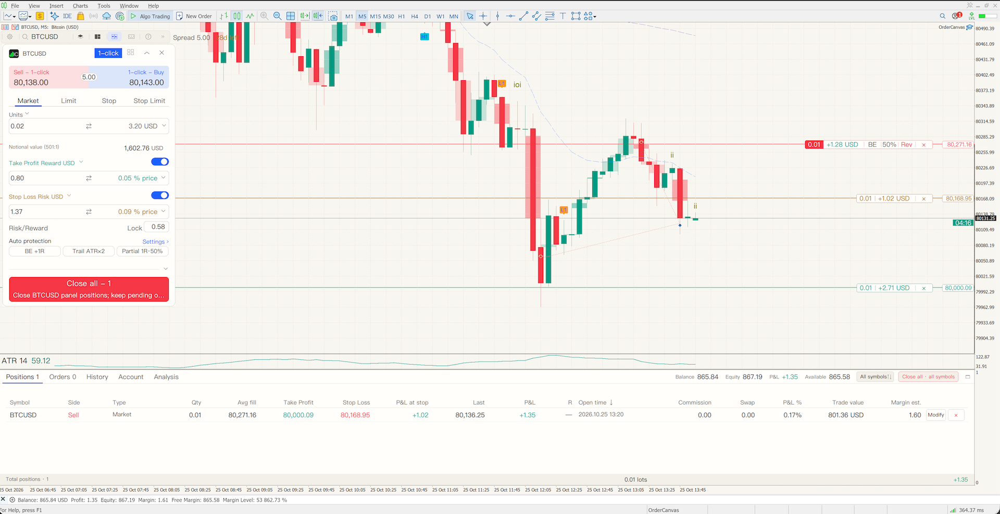
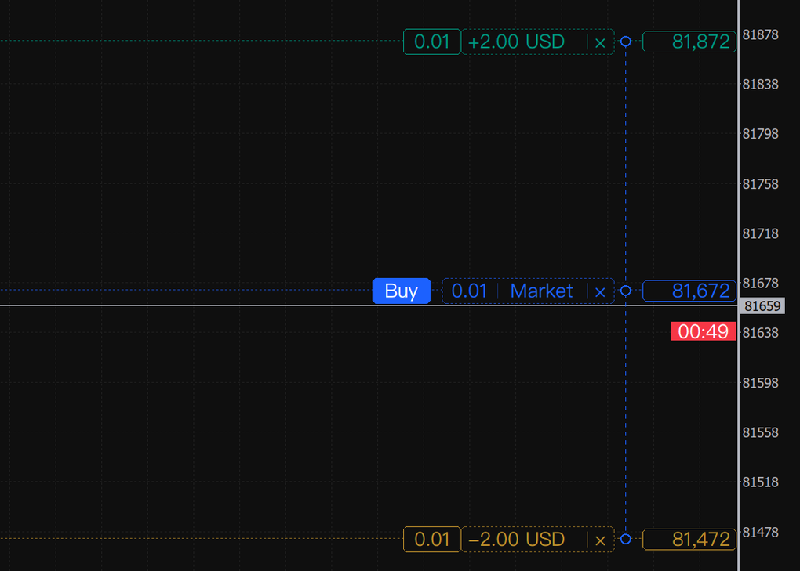
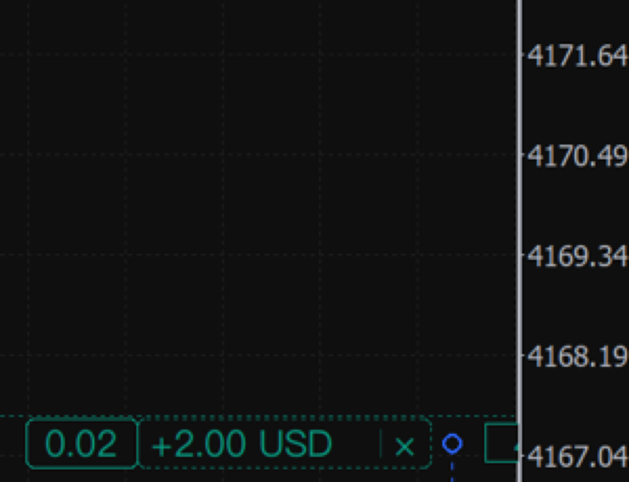
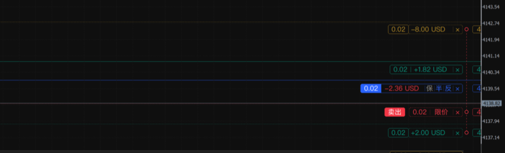
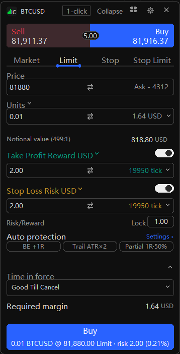
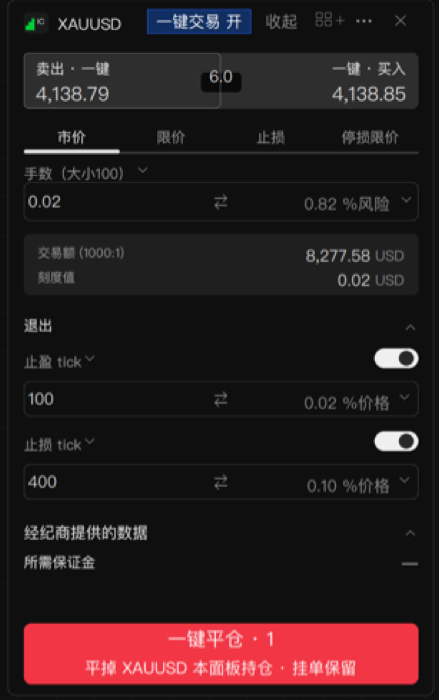
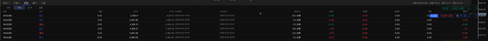
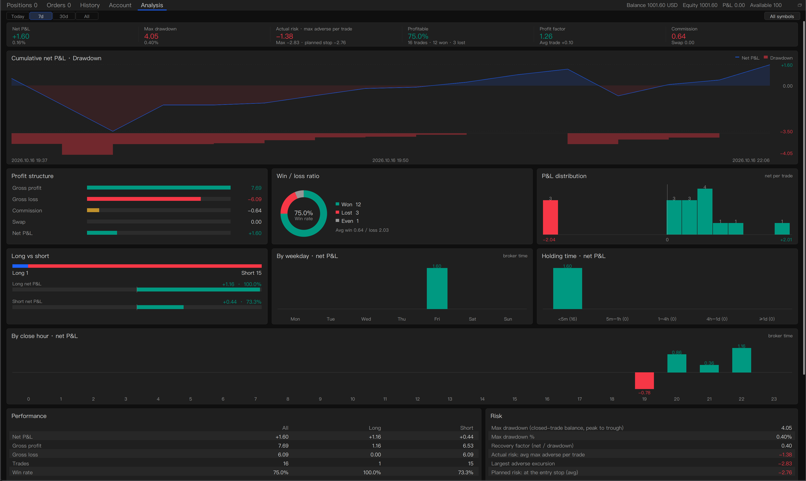
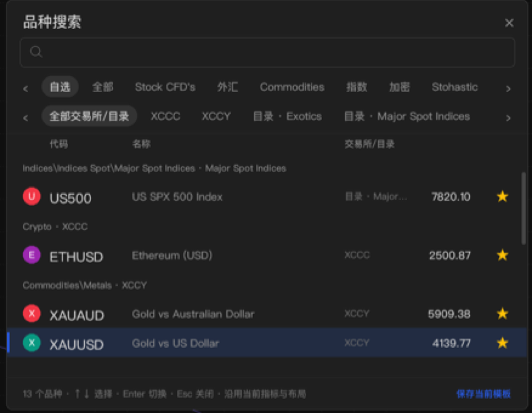

# OrderCanvas

**A modern chart-trading panel for MetaTrader 5**

Preview every order on the chart before it is sent · drag order lines to modify · break-even, partial close and reverse right on the position line · built-in trade analytics

**English** · [中文](README.zh-CN.md)

[Website & purchase](https://devspace-ntpa.tail545cd.ts.net/oc/shop) · [Download](https://github.com/lichunboa/OrderCanvas/releases/latest) · [Install guide](docs/INSTALL.md) · [All features](docs/FEATURES.md) · [Changelog](CHANGELOG.md) · [Telegram](https://t.me/OrderCanvasbot)

## Why OrderCanvas

MetaTrader 5 is a great execution platform, but placing and managing trades by hand is slow: a dialog for every order, lot sizes worked out on a calculator, protection edited through right-click menus. OrderCanvas moves the whole workflow onto the chart.

| Without | With OrderCanvas |
|---|---|
| A modal dialog for every order; lot size by hand | Pick a side - draft entry / TP / SL lines appear, **lots are sized from the stop distance** |
| Right-click → Modify → type prices | **Drag the order line**; pull a new TP / SL out of any order line |
| Break-even or half close needs mental math | **BE / ½ / Reverse / ×** buttons on the position line |
| Fat-finger orders | **Preview before sending**; confirmations appear next to the cursor |
| P&L analysis means exporting a report | **Analytics tab**: net P&L, win rate, profit factor, drawdown, equity curve |

## Core features

### 1. Draft preview before sending
Choose Buy or Sell and the order is drawn on the chart first - entry, take-profit and stop-loss as light dashed lines with their quantity, type and expected P&L. Drag any of them, then confirm. Nothing reaches the broker until you do.

 

### 2. Draggable order lines and position-line actions
Every position, pending order, TP and SL is a live line you can drag. Drag a TP/SL handle out of an order line to add protection. The position label carries its own actions:

- **BE** - move the stop to break-even, optionally covering commission, swap and a slippage buffer (configurable in ticks)
- **½** - partial close by a preset share (25 / 33 / 50 / 67 / 75 %)
- **Reverse** and **×** close - both confirmed next to the pointer by default

### 3. Professional order ticket
- Market, Limit, Stop and Stop-Limit orders; expiry GTC / today / specific time (with a calendar)
- **Five sizing modes**: lots, margin, % of balance, risk in money, risk in % - the lot size follows the stop distance
- TP / SL in ticks, price, % of price, pips, money or % of balance; reward:risk shown live
- Trade value, tick value and required margin from the broker, with the account currency
- Up to five saved order presets (type, offset, protection, expiry)

 

### 4. One-click trading
Turn on *1-click* in the ticket header: the Sell / Buy quotes become instant market buttons and the bottom action becomes *Close all* for this symbol (right-hand screenshot above).

### 5. Order panel and trade analytics
A dock under the chart with **Positions, Orders, History, Account and Analytics**. History shows open/close times, holding time, commission, swap and net P&L. Analytics puts net P&L, win rate, profit factor, average win/loss, maximum drawdown and the equity curve on one screen. Hovering a row highlights its lines on the chart.

## More

- **Staged take-profit** - up to three extra TP levels per position, each closing its share automatically; kept across terminal restarts
- **Hotkeys** - Ctrl+Shift+letter for buy, sell, close, break-even, partial close and collapse, with a configurable cooldown
- **Symbol search** grouped by category and exchange, favourites, keyboard navigation
- **Chart workflow** - wheel zoom, drag to pan, free vertical scale, candle countdown, dark theme, EMA 20 / ATR 14
- **Interface** in English or Chinese (follows the terminal by default)
- **Accounts** - hedging, netting and exchange accounts (netting partial closes use an opposite deal)

## Under the hood

OrderCanvas is written in pure MQL5 - no DLLs, no external services, no network access.

- **Broker-authoritative state.** Chart lines are rebuilt from the terminal's positions and orders after every trade transaction; the panel never keeps a shadow copy that could drift from what the broker holds.
- **Exact identity for every action.** A modify, close or reverse is bound to the ticket, account, symbol and magic number it was created for; a click that arrives after the book has changed is rejected instead of acting on another order.
- **Only its own orders.** By default the panel manages orders with its own magic number and leaves other EAs and manual trades alone.
- **Fast rendering.** The ticket is drawn on a Canvas with dirty-region scheduling; order-line labels are rounded Canvas skins over native click targets. Measured on the EA side: about 1.3 ms per drag frame and 0.5 ms per hover.
- **DPI-aware.** Text and layout scale with the screen DPI and the interface font is chosen per platform (Microsoft YaHei UI on Windows, PingFang on macOS), so the panel looks the same on a 96-DPI Windows desktop and a Retina Mac.
- **Safety defaults.** Live accounts show a one-time risk confirmation; close and reverse confirm by default.
- **Tested.** Unit and contract tests for the domain logic, plus Strategy Tester runs on Windows and macOS across gold, FX, indices and crypto with every tick model - including visual mode.

## Download

**[⬇ Download the latest release (OrderCanvas.zip)](https://github.com/lichunboa/OrderCanvas/releases/latest)** · [All versions](https://github.com/lichunboa/OrderCanvas/releases)

The package contains the program, the recommended chart template and a one-click Windows installer. It runs in the Strategy Tester without a key; on a live or demo chart it needs a license key (free 7-day trial available).

## Install

Download `OrderCanvas.zip`, unzip it and double-click **`Install.bat`** (Windows) - it installs the program and the recommended chart template into every MetaTrader 5 on the PC. Restart MT5, right-click a chart → *Templates* → **OrderCanvas**, then paste your key into the license card on the chart and click **Activate** (or F7 → *Inputs* → `LicenseKey`).
macOS / manual install and screenshots of each step: [docs/INSTALL.md](docs/INSTALL.md).

## License & pricing

| Plan | Price | Accounts |
|---|---|---|
| Free trial | 0 · 7 days | 1 |
| Monthly | 19 USDT | 2 |
| Yearly | 69 USDT | 2 |
| Lifetime | 89 USDT | 2, including updates |

Buy on the [website](https://devspace-ntpa.tail545cd.ts.net/oc/shop) or in Telegram [@OrderCanvasbot](https://t.me/OrderCanvasbot). Payment is USDT (TRC20); every order has unique cents (e.g. 19.37) so the payment is matched and the key delivered automatically. Keys are bound to the MT5 account number and verified offline. The **Strategy Tester runs every feature without a key** - try it before you buy. Invite a friend and get 15 days for every paid referral.

## Risk notice

Trading foreign exchange, metals and CFDs on margin carries a high level of risk and may not be suitable for all investors. OrderCanvas is a trading tool; it provides no signals and no investment advice. Practise on a demo account first.

© 2026 OrderCanvas. All rights reserved. See [LICENSE](LICENSE).
