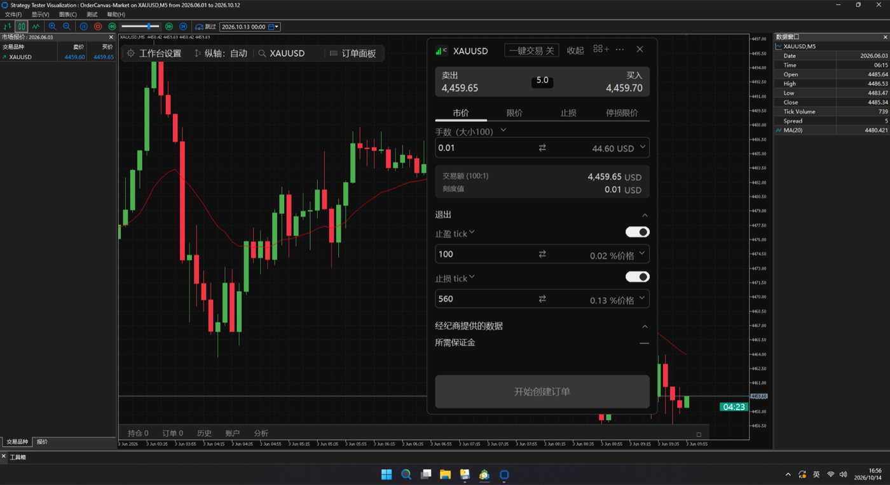

# OrderCanvas

### 让 MT5 下单像专业交易平台一样顺手
**先在图上预览，再发送 · 拖动订单线改价 · 持仓线一键保本 / 部分平仓 · 交易分析一屏看完**

[🛒 网页购买 / 免费试用](https://devspace-ntpa.tail545cd.ts.net/oc/shop) · [✈️ Telegram 购买](https://t.me/OrderCanvasbot) · [📘 安装激活](docs/INSTALL.md) · [📋 全部功能](docs/FEATURES.md) · [English](#english)

---

## 😩 MT5 下单，你是不是也这样？

| 以前 | 用 OrderCanvas |
|---|---|
| 每次下单弹出窗口，手算手数，行情一动就错过 | 图上点方向，入场 / 止盈 / 止损草稿线立刻出现，**按止损距离自动算手数** |
| 改止盈止损：右键 → 修改 → 填数字 → 确定 | **直接拖动订单线**，从订单线上拉出新的止盈 / 止损 |
| 保本、平一半、反手都要来回计算 | 持仓线上 **「保 / 半 / 反 / ×」一点即成**，保本可计入手续费和隔夜利息 |
| 手一抖下错方向、错手数 | **下单前先预览**，确认才发送；平仓、反手默认二次确认，确认框就在鼠标旁边 |
| 一周下来不知道钱赚在哪、亏在哪 | 订单面板自带 **交易分析**：净盈亏、胜率、利润因子、最大回撤、资金曲线 |

---

## ⭐ 核心功能

### 1. 下单前先预览 —— 草稿订单线
选好方向后，入场、止盈、止损先以**浅色虚线**画在图上，标签里显示数量、类型和预计盈亏。拖到满意的位置再点确认，告别手抖下错单。

 

### 2. 订单线直接拖 + 持仓线一键管理
持仓、挂单、止盈、止损都能**直接拖动改价**；从订单线上拉出 TP / SL 就是新的保护单。持仓线自带操作按钮：

- **保**：移到保本，可计入手续费、隔夜利息和滑点缓冲（在设置里调）
- **半**：按比例部分平仓（25 / 33 / 50 / 67 / 75%）
- **反**：一键反手 · **×**：平仓

### 3. 专业下单票据
市价 / 限价 / 止损 / 停损限价；挂单有效期（GTC / 当日 / 指定时间）；
**5 种算手数方式**：手数、保证金、余额 %、风险金额、风险 %（按止损距离反算）；
止盈止损可用 tick、价格、%、点数、金额、余额 % 表示，实时显示盈亏比和所需保证金。

 

### 4. 一键交易
标题栏打开「一键交易」，点卖价 / 买价直接成交，底部按钮变成「一键平仓」，适合剥头皮和快速进出（上右图）。

### 5. 订单面板 + 交易分析
底部订单面板：**持仓 / 订单 / 历史 / 账户 / 分析** 五页。历史里有开平仓时间、持仓时长、手续费、库存费和净盈亏；分析页一屏看完净盈亏、胜率、利润因子、平均盈亏、最大回撤和资金曲线。

---

## 🧩 更多细节

| | |
|---|---|
| 🔍 **品种搜索** | 按类别和交易所分组、自选星标、键盘上下选择，搜索按精确 > 前缀 > 包含排序 |
| 🪜 **分批止盈** | 每个持仓最多 3 个额外止盈价位，到价自动按比例平仓，重启终端后保留 |
| ⌨️ **快捷键** | Ctrl+Shift+字母：一键买 / 卖 / 平仓 / 保本 / 部分平仓，可设冷却时间防误触 |
| 💾 **订单预设** | 保存类型、偏移、止盈止损、有效期，最多 5 组 |
| ⏱️ **K 线倒计时**、滚轮缩放、拖动平移、深色主题 | |
| 🌏 **中文 / English**，Windows 与 Mac 都可用，对冲与净额账户都支持 | |
| 🛡️ **安全** | 真实账户首次使用弹出风险确认；所有修改和平仓绑定具体订单号、账户、品种；只管理本面板的订单 |

Windows 策略测试器（可视化模式）里同样能用，买之前可以先回测体验：

---

## 💰 价格

| 方案 | 价格 | 说明 |
|---|---|---|
| 🎁 免费试用 | 0 | 7 天，1 个 MT5 账户 |
| 月付 | **19 USDT** | 2 个 MT5 账户（如模拟 + 真实） |
| 年付 ⭐ | **69 USDT** | 2 个 MT5 账户，约 7 折 |
| 永久 | **89 USDT** | 2 个 MT5 账户，含后续更新 |

### 怎么买（两种方式任选）
- **网页**：打开 [购买页](https://devspace-ntpa.tail545cd.ts.net/oc/shop) → 选方案 → 填 MT5 账户号码 → 按页面金额转 USDT（TRC20）→ 到账后页面直接显示授权码，可下载程序。
- **Telegram**：打开 [@OrderCanvasbot](https://t.me/OrderCanvasbot) → `/start` → 选方案 → 发送账户号码 → 转账 → 自动收到授权码和程序。

> 💡 **为什么付款金额带小数（如 19.688）？** 每个订单金额都不同，系统靠小数尾数自动认出你的订单，到账后 1–3 分钟自动发码。请**完全照抄**金额转账；从交易所提币时请确保**到账金额**正好是这个数（手续费另付）。转错了也不用担心，联系卖家人工确认。

> 🧪 MT5 策略测试器里不需要授权码，可以随时回测体验全部功能。

## 📘 安装激活（3 步）

1. 把 `OrderCanvas.ex5` 放进 MT5 **文件 → 打开数据文件夹 → MQL5 → Experts**，导航器里右键 **刷新**；
2. 把 OrderCanvas 拖到图表，勾选 **允许算法交易**；
3. 按 **F7 → 输入参数 → LicenseKey** 粘贴授权码 → 确定。同一台电脑只需输入一次。

详见 [docs/INSTALL.md](docs/INSTALL.md)。授权离线校验，不联网、不用 DLL、不收集任何交易数据。

## ⚠️ 风险提示
外汇、贵金属和差价合约交易风险很高，可能损失全部本金。OrderCanvas 是交易操作工具，不提供交易信号或投资建议，请先在模拟账户熟悉。

---

## English

**OrderCanvas — trade on the MT5 chart like on a modern trading platform.**

| The old way | With OrderCanvas |
|---|---|
| A dialog per order, lot size by hand | Pick a side: draft entry / TP / SL lines appear, **lots sized from the stop distance** |
| Right-click → modify → type prices | **Drag order lines**; pull a new TP/SL out of an order line |
| Break-even / half close by mental math | **BE / ½ / reverse / ×** on the position line (BE can cover commission and swap) |
| Fat-finger orders | **Preview before sending**; confirmations next to the cursor |
| No idea where the P&L came from | Built-in **analytics**: net P&L, win rate, profit factor, drawdown, equity curve |

Core: draft preview · draggable order lines · position-line actions · pro ticket (market/limit/stop/stop-limit, 5 sizing modes, TP/SL in ticks/price/%/pips/money) · one-click trading · order panel + analytics.
More: symbol search, staged take-profit (3 levels), hotkeys with cooldown, presets, candle countdown, English/中文, Windows & Mac, hedging & netting, live-account safety confirmation.

**Pricing:** free 7-day trial · 19 USDT/month · 69 USDT/year · 89 USDT lifetime (2 MT5 accounts).
**Buy:** [web shop](https://devspace-ntpa.tail545cd.ts.net/oc/shop) or Telegram [@OrderCanvasbot](https://t.me/OrderCanvasbot) — pay USDT (TRC20); the key and the program arrive automatically. Every order has a unique amount (e.g. 19.688): send exactly that amount so the payment is matched automatically.
**Activate:** copy `OrderCanvas.ex5` to `MQL5/Experts`, attach to a chart, F7 → Inputs → `LicenseKey`. The Strategy Tester runs every feature without a key.

*Trading leveraged products carries a high risk of loss. OrderCanvas is a trading tool, not investment advice.*

© 2026 OrderCanvas. All rights reserved. See [LICENSE](LICENSE).
