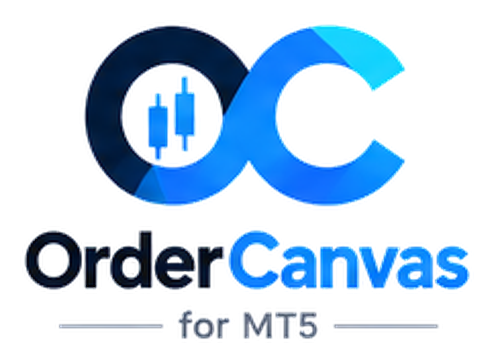
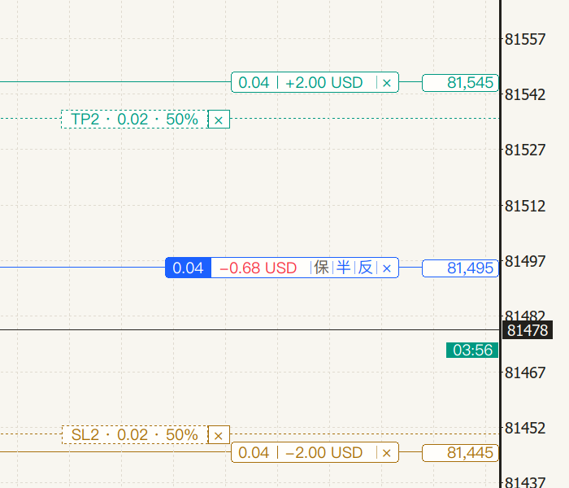
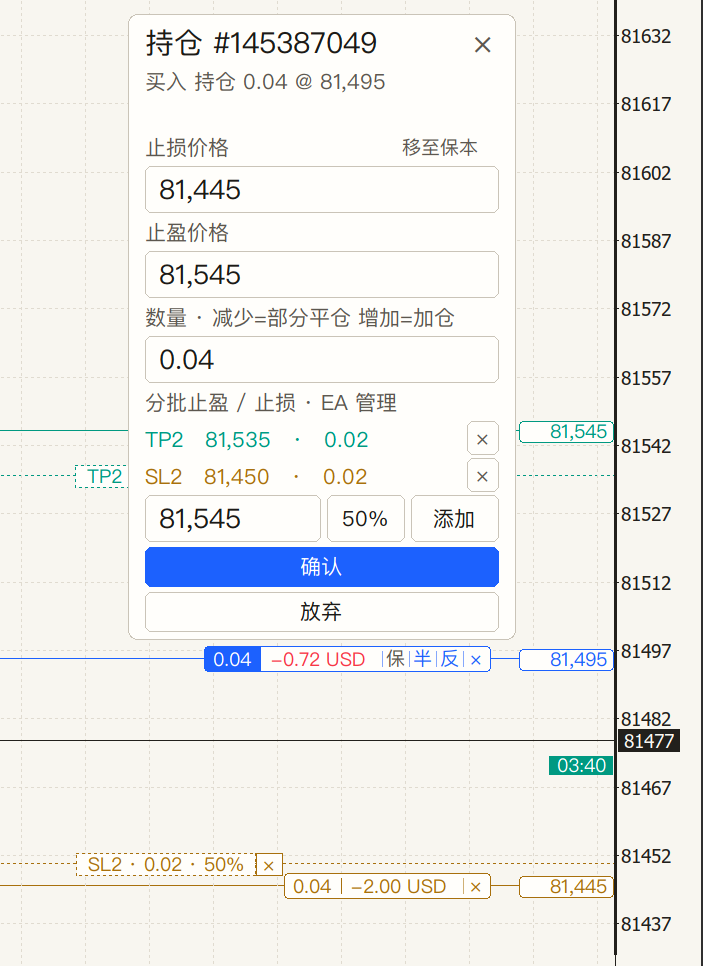
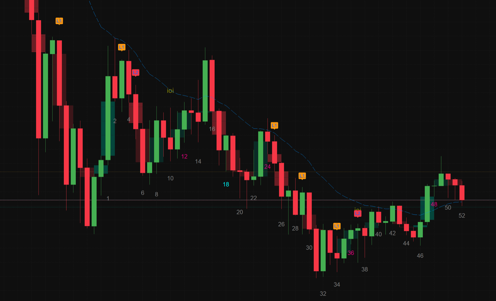
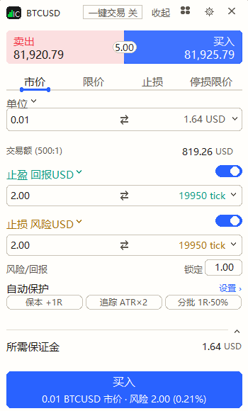

<picture>
  <source media="(prefers-color-scheme: dark)" srcset="assets/brand/logo-dark-transparent-6x.png">
  <source media="(prefers-color-scheme: light)" srcset="assets/brand/logo-light-transparent-6x.png">
  
</picture>

# OrderCanvas

**MetaTrader 5 现代化图表交易面板**

先在图上预览订单再发送 · 拖动订单线改价 · 持仓线一键保本 / 部分平仓 / 反手 · 策略报告式交易分析 · 内置开源价格行为工作台

[English](README.md) · **中文**

[正式官网](https://getordercanvas.com/oc/shop?lang=zh) · [MQL5 Market](https://www.mql5.com/en/market/product/201771) · [下载](https://github.com/lichunboa/OrderCanvas/releases/latest) · [安装教程](docs/INSTALL.md) · [全部功能](docs/FEATURES.zh-CN.md) · [更新日志](CHANGELOG.md) · [Telegram](https://t.me/OrderCanvasbot)

## 你想从哪里开始？

| 目的 | 快速入口 |
|---|---|
| **安装并使用交易面板** | [功能介绍](docs/FEATURES.zh-CN.md) · [安装说明](docs/INSTALL.md) · [发布版本](https://github.com/lichunboa/OrderCanvas/releases) |
| **学习或复用开源代码** | [开发者入门](docs/DEVELOPERS.zh-CN.md) · [MIT 基础工具](OpenUtilities/) · [MPL 指标源码](TVStudySuite/) |
| **参与开发或反馈问题** | [仓库结构](docs/PROJECT_STRUCTURE.md) · [贡献指南](CONTRIBUTING.md) · [问题反馈](https://github.com/lichunboa/OrderCanvas/issues) · [讨论区](https://github.com/lichunboa/OrderCanvas/discussions) · [安全报告](SECURITY.md) · [社区与支持分流](docs/COMMUNITY.zh-CN.md) |

**这是混合授权仓库：**核心 UI、交易执行和授权系统仍为闭源。[开源与商业许可说明](docs/OPEN_SOURCE.zh-CN.md)。

## 开源工具与商业交易面板

**已公开的源代码：**[OpenUtilities](OpenUtilities/)（MIT：独立手数计算、K 线倒计时、有效期日历、区域重叠与鼠标／滚轮数学工具）及 [TVStudySuite](TVStudySuite/)（MPL-2.0：价格行为指标工作台，保留原作者来源说明）。**仍为商业闭源：**OrderCanvas 图表交易面板、交易执行与 UI 内部实现、授权验证。开源上述工具不代表公开整个 EX5 或授权系统。查看 [开源范围、商业许可与第三方致谢](docs/OPEN_SOURCE.zh-CN.md) · [贡献指南](CONTRIBUTING.md)。

## 三步上手

1. **[下载 `OrderCanvas.zip`](https://github.com/lichunboa/OrderCanvas/releases/latest)**，解压后双击 **`Install.bat`**。
2. 重启 MT5，把 **OrderCanvas** 从导航器拖到图表，打开「算法交易」。你原来的图表不变；想要我们的样式和指标，用面板工具栏「模板」一键套用。
3. 在图表上的授权卡片里粘贴授权码，点 **激活**；也可以先在**策略测试器里免授权**体验全部功能。

## 为什么做 OrderCanvas

MT5 执行很稳，但手动下单和管理很慢：每次下单都弹窗、手数要拿计算器算、改止盈止损要右键菜单。OrderCanvas 把整套流程搬到图表上。

| 以前 | 用 OrderCanvas |
|---|---|
| 每次下单弹窗，手算手数 | 选方向后草稿线立刻出现，**按止损距离自动算手数** |
| 右键 → 修改 → 填数字 | **直接拖动订单线**，从订单线拉出新的止盈 / 止损 |
| 保本、平一半要心算 | 持仓线上 **保 / 半 / 反 / ×** 一点即成 |
| 手一抖下错单 | **下单前预览**，确认框就在鼠标旁边 |
| 分析盈亏要导出报告 | **分析页**：关键指标、资金曲线 + 回撤、盈亏分布、胜负、多空、按时段和星期的图表 |
| 价格行为指标要另外找 | **内置工作台**：缺口、内包/外包、昨日高低点、K线计数、H1/H2/L1/L2 信号 |

大多数 MT5 交易面板都能拖线、按止损算手数，OrderCanvas 也能；不同在那些一出错就亏钱的细节：

- **确认前什么都不发。** 草稿先画在图上、可以拖，误点不会成交。
- **每个操作都绑定它创建时的那张单**（订单号、账户、品种、魔术号）；单子变了就拒绝执行，不会打到别的单上。
- **分析就在下单的地方**：可停靠的订单面板，历史 + 完整的策略报告式分析页，不用导出 HTML 报告。

## 核心功能

### 1. 下单前先预览
选买或卖后，订单先画在图上：入场、止盈、止损以浅色虚线显示数量、类型和预计盈亏。拖到满意位置再确认，确认前不会发给券商。

 

### 2. 订单线直接拖 + 持仓线一键管理
持仓、挂单、止盈、止损都是可拖动的线；从订单线拉出止盈 / 止损就是新的保护单。持仓标签自带操作：

- **保**：移到保本，可计入手续费、隔夜利息和滑点缓冲（tick 可设）
- **半**：按预设比例部分平仓（25 / 33 / 50 / 67 / 75%）；把「半」**拖出来**：拖向盈利方向是分批止盈，拖向亏损方向是分批止损（点标签切换比例）
- **反** 反手、**×** 平仓，默认在鼠标旁边二次确认

拖动止盈、止损或挂单线，松开即生效（和 TradingView 一样）；设置里可改为先显示「放弃 / 确认」。点击线上的盈亏金额，编辑框直接出现在这条线旁边：止损 / 止盈、数量、分批价位。

 

### 3. 专业下单票据
- 市价 / 限价 / 止损 / 停损限价；挂单有效期 GTC / 当日 / 指定时间（带日历）
- **5 种算手数方式**：手数、保证金、余额 %、风险金额、风险 %，手数跟随止损距离
- 止盈止损默认按盈亏金额，也可用 tick、价格、%、点数、余额 % 表示，实时显示盈亏比
- 券商提供的交易额、刻度值、所需保证金
- 最多 5 组订单预设（类型、偏移、止盈止损、有效期）

 

### 4. 一键交易
标题栏打开「一键交易」，点卖价 / 买价立即按当前页签下单：市价页直接成交，限价 / 止损页按面板价格挂单；市价页底部按钮变为本品种「一键平仓」（上右图）。开启一键交易后，订单线和订单面板上的平仓、撤单、部分平仓、反手都直接执行，不再弹确认框。

### 5. 订单面板 + 交易分析
图表下方的面板：**持仓 / 订单 / 历史 / 账户 / 分析**。历史含开平仓时间、持仓时长、手续费、库存费和净盈亏，悬停某行图上对应订单线高亮。**分析页**像一份策略报告：顶部关键指标（净盈亏、最大回撤、交易数、胜率、利润因子、费用），资金曲线 + 回撤（悬停查看每笔），然后是盈亏结构、胜负比例、盈亏分布、多空对比、按星期、持有时长、按平仓小时的图表，以及绩效、风险、品种表。可选今天 / 7 天 / 30 天 / 全部、本品种或全部品种；最大化后占满整个图表。每笔已平仓交易还显示**实际风险**——持仓期间的最大浮亏（MAE），和止损计划的风险并列。

### 6. 价格行为工作台（内置、开源）
OrderCanvas 自带 **TVStudySuite** 价格行为工作台，直接画在 MT5 图表上：

- **均线与形态**：图表 EMA 和另一周期 EMA、开盘/影线/实体缺口、OO / II / IOI、昨日高低点和收盘价
- **K线计数**：带时段过滤和特殊数字颜色的 K 线编号
- **入场信号**：H1 / H2 / L1 / L2 二次入场标签，可选收盘提醒

每个模块、颜色和大小都在「工作台设置 → 下拉选择页面」里设置。工作台是三个开源 TradingView 脚本的 MT5 移植，按 **MPL-2.0** 开源，完整源码、许可和来源说明见 [`TVStudySuite/`](TVStudySuite)；安装时也会作为独立指标放进「指标」，可以单独加到任意图表。

### 7. 风险上限与自动保护（默认关闭）
- **点差上限**（按品种）和**单笔风险上限**（占净值 %，按止损距离计算）：超过上限时下单按钮直接写明原因，不会发单
- **自动保本**：持仓盈利达到 +0.5R / +1R / +1.5R / +2R 时把止损移到保本（计入手续费）；R 是开仓时的止损距离，终端重启后仍然记得
- **追踪止损**：每根 K 线收盘时，止损跟随 ATR(14) × k、最近 N 根K线的低点 / 高点、或固定 k × R，只收紧不放宽；可开仓即追踪，也可保本后开始
- **自动部分平仓**：盈利达到 +x R 时平掉 y%，每个持仓一次
- 三个开关就在下单面板止盈止损下面，并直接写出规则（保本 +1R · 追踪 ATR×2 · 分批 1R·50%），「设置 ›」进入详细参数
- 需要 MT5 和这张图表保持打开（这是 EA，不是券商服务器上的止损），只管理本面板魔术号的单

## 功能清单

选 MT5 交易面板时大家常比较的功能，OrderCanvas 都有：

| 功能 | OrderCanvas |
|---|---|
| 按风险 % / 风险金额 / 余额 % / 保证金算手数 | ✅ 票据里设置，随止损距离变化 |
| 拖动入场 / 止损 / 止盈线，从订单线拉出新的止盈止损 | ✅ |
| 下单前预览 | ✅ 草稿线，确认前不发单 |
| 一键保本（计手续费、隔夜利息、滑点缓冲） | ✅ 持仓线「保」 |
| 盈利达到 R 倍自动保本 | ✅ +0.5R ~ +2R |
| 追踪止损 | ✅ ATR / 摆动高低点 / 固定 R，K 线收盘时只收紧 |
| 部分平仓 / 分批止盈止损 | ✅ 25~100%，拖出「半」放分批止盈、分批止损各最多 3 个；到 xR 自动部分平仓 |
| 一键交易、本品种平仓 / 全部平仓 | ✅ |
| 快捷键：单键买卖、鼠标点哪下哪、止损止盈跟随鼠标 | ✅ 直接输入键位、跟随鼠标模式 |
| 点差上限 / 单笔风险上限 | ✅ |
| 挂单有效期、订单预设 | ✅ GTC / 当日 / 指定时间，5 组预设 |
| 图表内交易历史与绩效分析 | ✅ |
| 对冲、净额、交易所账户 | ✅ |
| 不用 DLL、不联网、策略测试器可用 | ✅ |

## 更多

- **分批止盈 / 止损**：把持仓线上的「半」拖出来（盈利方向 = 止盈，亏损方向 = 止损），分批止盈、分批止损各最多 3 个，标签显示比例和到价盈亏，到价自动按比例平仓，副图同步显示，重启终端后保留
- **快捷键**：直接输入按键或组合（B、Shift+S、Ctrl+Shift+X、F2）：市价买 / 卖、平仓、保本、部分平仓、收起；**跟随鼠标**——Shift+B / Shift+S 订单跟着鼠标走、点击即下单（按位置自动判断限价或止损单），Shift+L / Shift+P 止损 / 止盈跟着鼠标走；Shift+T 循环切换订单类型。左键下单、右键取消，只有被拒绝时才会提示。工具栏开关一键开 / 关（默认关闭）
- **价格框**：订单线右端的价格框，点击直接输入价格，按住拖动移动这条线
- **副图与多图布局**：工具栏「副图」打开本品种任意周期的真正 MT5 图表，8 种排布（例如左二右大：左边两个小图、本图在右侧放大）；每个副图只显示品种和周期按钮，用浅色带标出主图正在看的区间，订单线简化显示；「还原单图」关闭副图，「放回 MT5 窗口」保留副图（Alt+R 平铺）
- **模板**：6 种预设（价格行为、纯净K线、趋势均线、布林+RSI、MACD、成交量），指标为 TradingView 风格、统一 2px；也可套用你自己的模板，输入名字按 Enter 即保存
- **实时点差**显示在工具栏旁（可关闭），以及 6 步**新手引导**，每步一个小任务
- **品种搜索**：按类别和交易所分组、自选、键盘选择
- **图表操作**：滚轮缩放、拖动平移、纵轴自由缩放、K 线倒计时、浅色 / 深色 / 自动主题（自动跟随图表背景）、EMA20 / ATR14
- **界面** 中文 / English（默认跟随终端）
- **账户** 对冲、净额、交易所账户（净额账户部分平仓用反向成交）

## 技术实现

纯 MQL5 编写，不用 DLL、不依赖外部服务、不联网。

- **以券商为准**：每次交易事务后都从终端的持仓和挂单重建图上订单线，面板不保存可能与券商不一致的影子状态。
- **每个操作都绑定精确身份**：修改、平仓、反手都绑定当时的订单号、账户、品种和魔术号；界面变化后到达的旧点击会被拒绝，不会误操作别的订单。
- **只管自己的订单**：默认只管理本面板魔术号的订单，不动其他 EA 和手动单。
- **渲染快**：下单票据用 Canvas 绘制并按脏区刷新；订单线标签是圆角 Canvas 外观加原生点击区。EA 侧实测拖动每帧约 1.3 ms、悬停 0.5 ms。
- **适配屏幕精度**：文字和布局随屏幕 DPI 缩放，界面字体按系统自动选择（Windows 微软雅黑 UI、macOS 苹方），96 DPI 的 Windows 和 Retina 的 Mac 显示一致。
- **安全默认值**：真实账户首次使用弹出风险确认；平仓、反手默认二次确认。
- **测试**：领域逻辑有单元和契约测试；在 Windows 和 macOS 的策略测试器里用黄金、外汇、指数、加密货币和各种报价模型跑过，包括可视化模式。

## 下载

**[⬇ 下载最新版本（OrderCanvas.zip）](https://github.com/lichunboa/OrderCanvas/releases/latest)** · [全部历史版本](https://github.com/lichunboa/OrderCanvas/releases)

安装包含程序、推荐图表模板、TVStudySuite 工作台（编译版 + MPL-2.0 源码）和 Windows 一键安装程序。策略测试器里不需要授权码；在实盘或模拟图表上需要授权码（可免费试用 7 天）。所有历史版本都保留在 [Releases](https://github.com/lichunboa/OrderCanvas/releases)。

## 安装

下载 `OrderCanvas.zip`，解压后双击 **`Install.bat`**（Windows），或在终端运行 `Install-Mac.command`（Mac），程序和推荐图表模板会装进这台电脑上所有的 MT5。重启 MT5，图表右键 → 模板 → **OrderCanvas**，在图表上弹出的授权卡片里粘贴授权码，点 **激活**（也可以 F7 → 输入参数 → `LicenseKey`）。之后工具栏会显示剩余天数和到期日。
Mac、便携版、手动安装和每一步说明：[docs/INSTALL.md](docs/INSTALL.md)。

## 授权与价格

| 方案 | 价格 | 账户 |
|---|---|---|
| 免费试用 | 0 · 7 天 | 1 |
| 月付 | 19 USDT | 2 |
| 年付 | 69 USDT | 2 |
| 永久 | 89 USDT | 2，含后续更新 |

独立授权版本可在 [正式官网](https://getordercanvas.com/oc/shop?lang=zh) 或 Telegram [@OrderCanvasbot](https://t.me/OrderCanvasbot) 购买。用 USDT（TRC20）付款，每个订单金额的小数尾数不同（如 19.37），到账后自动识别并发授权码。授权码绑定 MT5 账户号码、离线校验。**策略测试器里不需要授权码**，可以先回测体验。邀请好友付费购买，每单送你 15 天。

## 常见问题

**Mac 能用吗？** 能。Mac 版 MT5（Wine）和 Windows 都测试过，布局和字体按屏幕 DPI 自适应。

**会动我其他 EA 或手动单吗？** 不会。默认只管理本面板魔术号的订单，其他持仓只读显示。

**对冲还是净额账户？** 都支持，也支持交易所账户；净额账户部分平仓用反向成交。

**能先试用吗？** 能。策略测试器里免授权使用全部功能；实盘/模拟账户可领 7 天免费授权。

**会自动交易吗？** 不会。这是手动交易和分析工具，没有信号、不自动开仓；分批止盈和保本只在你设置后执行。

**升级后授权码还能用吗？** 能。授权码绑定 MT5 账户号码，与版本无关，新版本直接覆盖安装。

## 风险提示

保证金交易外汇、贵金属和差价合约风险很高，未必适合所有投资者。OrderCanvas 是交易操作工具，不提供交易信号或投资建议，请先在模拟账户练习。

OrderCanvas 是独立产品，与 MetaQuotes、TradingView 没有关联，也未获其背书。

© 2026 OrderCanvas. 保留所有权利。见 [LICENSE](LICENSE)。TVStudySuite 工作台单独按 MPL-2.0 授权（[TVStudySuite/](TVStudySuite)）。
