# OrderCanvas for MetaTrader 5 — User Guide (v1.15.2)

[中文](USER_GUIDE.zh-CN.md) · **English** · [Back to README](../README.md) · [Feature List](FEATURES.md) · [Install Guide](INSTALL.md)

OrderCanvas is a native on-chart trading workbench for **MetaTrader 5 (MT5)** written in pure MQL5 with zero DLLs for Windows and macOS. It unifies **pre-order draft preview, fixed-risk lot sizing, interactive order lines, cost-aware automated protection, in-place historical bar & tick replay, price-action studies, and net P&L / MAE analytics** directly on a single MT5 chart canvas.

---

## Table of Contents

1. [Quick Start & Five-Zone Workspace Architecture](#1-quick-start--five-zone-workspace-architecture)
2. [Plan & Place: The Left Order Ticket](#2-plan--place-the-left-order-ticket)
3. [Chart Order Lines & Three-State TP/SL](#3-chart-order-lines--three-state-tpsl)
4. [Cross-Source Trade Management & 5-Tab Bottom Dock](#4-cross-source-trade-management--5-tab-bottom-dock)
5. [Automated Protection & Pre-Trade Risk Guards](#5-automated-protection--pre-trade-risk-guards)
6. [In-Chart Historical Replay Mode](#6-in-chart-historical-replay-mode)
7. [Price-Action Workbench, Native Calendar & Multi-Chart Layouts](#7-price-action-workbench-native-calendar--multi-chart-layouts)
8. [Workbench Settings (Instant Live Preview), Hotkeys & Troubleshooting](#8-workbench-settings-instant-live-preview-hotkeys--troubleshooting)
- [Appendix: Installation & License Activation (GitHub / Self-Hosted Edition)](#appendix-installation--license-activation-github--self-hosted-edition)

---

## 1. Quick Start & Five-Zone Workspace Architecture

### 1.1 Workspace Architecture

OrderCanvas organizes the entire **Plan → Execute → Defend → Review** trading loop into five synchronized zones inside the MT5 chart canvas:

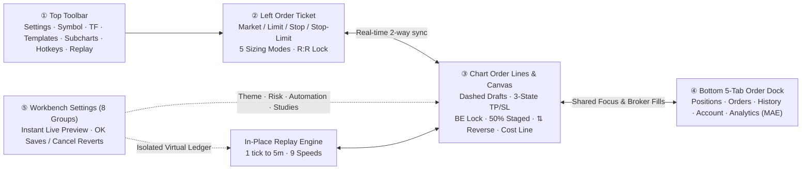

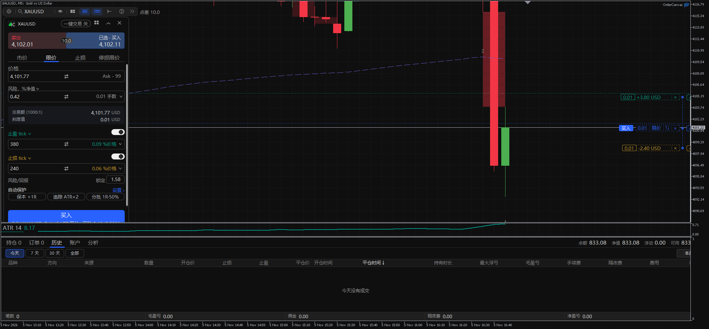

| Zone | Name | Location | Primary Role |
|---|---|---|---|
| **①** | **Top Toolbar** | Top-left horizontal bar | Open Settings, search symbols, switch timeframes, apply templates, open linked subcharts, toggle panels/hotkeys, launch **Replay Mode**, and monitor live spread |
| **②** | **Left Order Ticket** | Left side of chart (floating, docked, or collapsed) | Pick side & order type, auto-calculate lots from fixed risk, convert TP/SL units, lock reward:risk, and toggle auto-protection pills |
| **③** | **Chart Order Lines & Canvas** | Main candle chart & right price scale | Preview dashed drafts before sending, toggle active vs. gray reference TP/SL, defend positions in one click, drag out 3 staged exits, and view price-action / calendar badges |
| **④** | **Bottom 5-Tab Order Dock** | Dedicated bottom pane (collapsible / maximizable) | Manage positions & orders (including mobile and external EA trades), inline-edit SL/TP prices, audit closing SL/TP & sources, and inspect net equity + per-trade MAE |
| **⑤** | **Workbench Settings** | Resizable centered modal dialog | 8 focused groups, cross-group search, 16-color palette + `#HEX` custom colors, inline study accordions, and instant click-to-preview |

### 1.2 First Launch & One-Click Templates

> [!TIP]
> **Your existing chart stays untouched by default**: dragging `OrderCanvas` onto a chart adds only the trading panel and order lines without overwriting your candle colors or removing your existing indicators.

To apply the curated OrderCanvas workspace look in one click:
1. Make sure **Algo Trading** in MetaTrader 5's top toolbar is green.
2. Click **Templates** in the OrderCanvas toolbar and pick one of the 6 built-in presets:
   - **Price Action**: built-in open-source `TVStudySuite` (EMA 20 / 200, gap zones, `ii` / `ioi`, previous-day high/low/close, bar count, `H1/H2/L1/L2` entry badges) + `OC ATR 14`
   - **Clean Candles**: distraction-free dark/light candle canvas
   - **Trend EMAs (20 / 50 / 200)**, **Bollinger + RSI**, **MACD + EMA 20**, **Volume + EMA 20**
3. A movable **7-step interactive onboarding guide** opens automatically on first launch and can be reopened anytime via `?` in the toolbar.

---

## 2. Plan & Place: The Left Order Ticket

With **1-Click Trading** turned off, nothing is ever sent to your broker while you switch sides, type numbers, or drag dashed lines on the chart — **an order is transmitted only when you click the bottom submit button**.

### 2.1 Four Order Types & Instant Auto-Drafts

- **Market**: fills immediately at the current Bid / Ask quote.
- **Limit**: places a Buy Limit below market or Sell Limit above market (if dragged across the current market price, MT5 also supports marketable limit fills).
- **Stop**: places a breakout Buy Stop above market or Sell Stop below market.
- **Stop Limit**: places a **Trigger** stop line and a separate **Limit** execution line — once price reaches the trigger level, a Limit order is placed at your specified limit price.

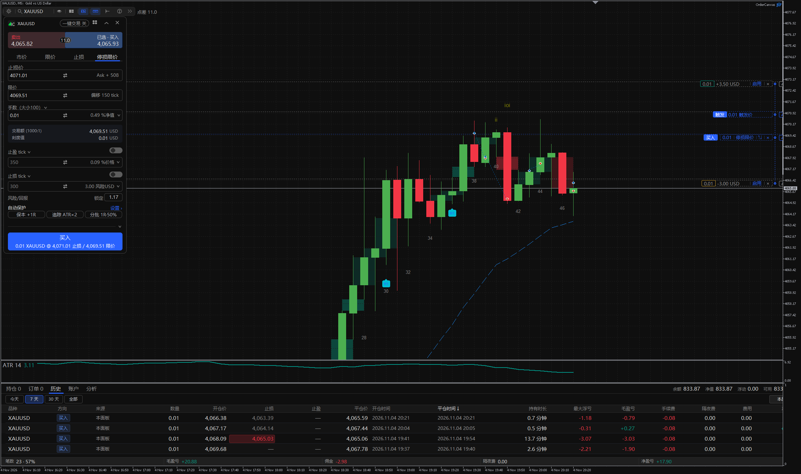

> [!NOTE]
> **Editing any field opens the chart draft automatically**: while neutral, clicking any order-type tab or editing size, entry, or TP/SL values immediately projects the dashed draft lines onto the chart.

### 2.2 Five Position-Sizing Modes (Risk-to-Lot Engine)

Click the **Units** selector on the ticket to switch between 5 sizing modes while viewing live equivalents on the right:

| Sizing Mode | What You Enter | What OrderCanvas Calculates | Best For |
|---|---|---|---|
| **Lots** | Fixed lot volume (e.g. `0.10`) | Required margin, monetary stop risk, and `% equity` | Fixed-volume execution |
| **Margin** | Margin to allocate (e.g. `200 USD`) | Tradable lots using the symbol's account leverage | Margin-constrained accounts |
| **% Equity** | Share of live account equity | Lots from live equity (including floating P&L) | Notional allocation |
| **Risk Money** | Max currency loss at stop (e.g. `100 USD`) | **Exact compliant lots from Entry-to-Stop distance** | Fixed-dollar risk per trade |
| **Risk %** | Max % of live equity at stop (e.g. `1.0%`) | **Real-time lots = (Equity × Risk %) ÷ Stop Distance** | Consistent institutional R-based sizing |

### 2.3 Multi-Unit TP/SL Conversion & R:R Lock

- **Six interchangeable TP/SL units**: P&L money (account currency), ticks, price, `% of price`, pips (forex), or `% of equity`. Switching units or temporarily having an invalid lot size never zeroes out your saved TP/SL price levels.
- **Reward:Risk `Lock`**: enter a target ratio (such as `2.0`) and activate **Lock** — dragging either your Stop Loss or Take Profit automatically scales the opposite exit to maintain your locked ratio.
- **Actionable validation messages**: if a stop is closer than the broker's freeze/stops level or a small account's `1%` budget cannot afford `0.01` lots, the exact reason is written directly above the field and on the submit button.

### 2.4 1-Click Trading, Collapsed Ticket & 5 Order Presets

- **1-Click Trading pill**: when enabled in the ticket header, clicking the live Sell / Buy quote boxes sends an order immediately (Market on the Market tab, or pending at the ticket price on Limit/Stop tabs), and the bottom button on the Market tab becomes **Close All**.
- **Collapse / Expand (`^`)**: folds the ticket into a compact mini-bar (Quotes + Type + Size + Submit) to maximize chart space.
- **5 Order Presets (grid icon)**: save up to five combinations of order type, entry offset, TP/SL distances, and expiry for one-click recall.

---

## 3. Chart Order Lines & Three-State TP/SL

Every draft, working pending order, and open position in OrderCanvas is rendered as an interactive horizontal line with connected price-axis tags.

### 3.1 Three-State TP / SL Workflow (Active Broker · Gray Reference · Hidden)

Traders often want to **size lots accurately from a planned stop and keep visual exit guides on the chart without exposing a server-side SL/TP order to the broker**. OrderCanvas handles this cleanly through three states:

| State | How to Enter | Chart Appearance | Broker & Sizing Behavior |
|---|---|---|---|
| **① Colored Active (Real Broker Exit)** | Turn ON the ticket TP/SL switch, or press `L` / `P` on the chart | Green (TP) / Amber (SL) line showing projected currency P&L | **Submits a real broker TP/SL** with the order; drives `Risk %` / `Risk Money` sizing |
| **② Gray Reference (Local Visual Guide)** | Turn OFF the ticket TP/SL switch while a level exists | Clean **gray dashed line** with `[-2.82 USD \| Enable \| ×]` | **No TP/SL is sent to the broker**, yet `Risk %` & `Risk Money` **still size lots from the gray stop distance** — and the gray reference lines **persist onto the live position or pending order after fill**! |
| **③ Completely Hidden** | Click `×` on the TP or SL chip | Line is removed from the chart | No TP/SL sent; drag the `TP`/`SL` handle out of the main order chip or press `L`/`P` anytime to pull out a fresh active exit |

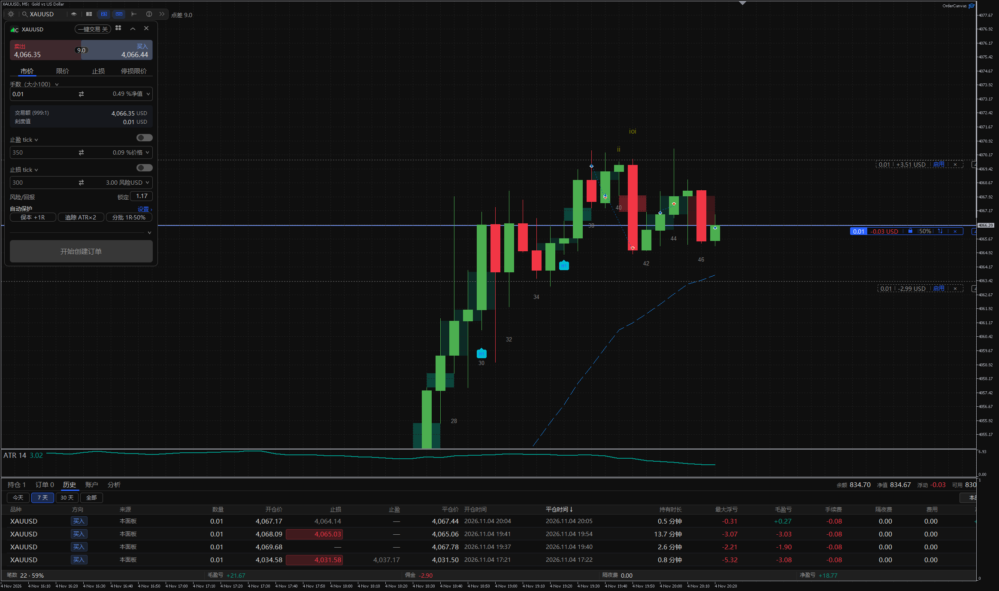

> [!IMPORTANT]
> **One-click promotion from Reference to Real SL/TP**: on any live position or pending order carrying a gray reference line, simply **drag the gray line** or click **`Enable` (`启用`)** on its chip to immediately transmit it to your broker as a live server-side SL/TP!

### 3.2 Ticket Buy/Sell Mirroring vs. On-Line `⇅` Same-Price Reverse

OrderCanvas distinguishes two complementary reversal workflows:

| Control Clicked | Behavior | Example Use Case |
|---|---|---|
| **Ticket Header `Buy` / `Sell` Boxes** | **Mirrors offset across Bid/Ask (keeps order type)**: Limit stays Limit on the opposite side of market; Stop stays Stop | Switching from a `Buy Limit` pullback below price to a `Sell Limit` fade above price |
| **Chart Order Line `⇅` Button** | **Reverses at the exact same price (`Limit <-> Stop`)**: line stays put, side flips, TP & SL swap distances | Flipping a `Buy Limit` at `4050` directly into a `Sell Stop` breakdown order at `4050` (if refused by the broker on a live pending order, the original order and its gray reference lines are restored intact) |

### 3.3 Position Line Defense, 3 Staged Exits & Average-Cost Line

- **Position Line Capsule `[Lots | Floating P&L | Lock | 50% | ⇅ | ×]`**:
  - **Break-Even Lock**: factors in **round-turn commission + accumulated swap** by default (plus optional extra points). Turns green once price clears net break-even to move your stop there; if the position is currently underwater, clicking Lock places your **Take Profit** at net break-even instead.
  - **Partial Close (`50%`)**: closes your configured share at market in one click.
  - **Reverse (`⇅`)**: closes the position and opens an equal-sized position in the opposite direction.
  - **Close (`×`)**: closes the position immediately (asks inline when 1-click is off).
- **Up to 3 Staged TP & Staged SL Lines**: drag `50%` out toward profit to create `TP1 / TP2 / TP3` staged take-profit lines (or toward loss for staged stop reductions). Click any staged chip to cycle `25% / 33% / 50% / 67% / 75% / 100%`; levels persist across MT5 restarts.
- **Average-Cost Line (`Shift+X`)**: when holding two or more positions on the same side, a purple dashed **Average-Cost Line** marks their combined net break-even price. Click its lock or press `Shift+X` to set every position on that side to exit at combined break-even.
- **Pending-Order Clock**: click the clock icon right on a pending line to switch expiry between `GTC`, `Today`, or `1 / 4 / 24 hours` with exact broker server timestamps.

### 3.4 Multi-Order Shared Focus & `···` Auto-Compact Chips

When two or more positions or pending orders appear on the same chart:
- **Unified trade focus**: clicking a chart order line, selecting a row in the bottom dock, or aiming with hotkeys synchronizes the **focused order** across the entire workspace.
- **Clutter-free `···` folding**: unfocused order lines automatically fold secondary action buttons into `···` so stacked orders never overlap; hovering, clicking `···`, or focusing the trade expands the full button bar immediately.

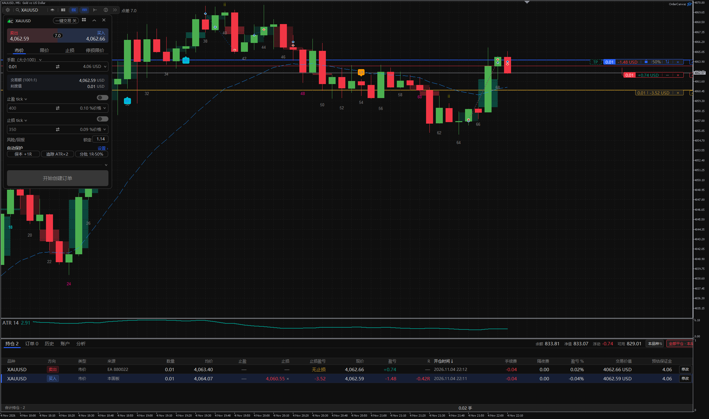

---

## 4. Cross-Source Trade Management & 5-Tab Bottom Dock

### 4.1 Managing Mobile, Web & Other EAs' Trades Safely

In `Settings → Orders`, **"Manage trades from other sources"** is enabled by default:
- Trades placed on **MT5 Mobile, Web, Desktop (`Magic 0`)**, or by **other EAs** on the current symbol appear on chart order lines and in the bottom dock so you can adjust TP/SL, close, or cancel them seamlessly.
- **Strict safety boundary**: **Auto Break-Even, Trailing Stop, Auto Partial Close, and the Average-Cost Line act ONLY on OrderCanvas trades and manual (`Magic 0`) trades** — they never mutate another EA's automated positions. Turn the setting off anytime if you prefer strict single-Magic isolation.

### 4.2 The Five-Tab Bottom Order & Analytics Dock

1. **Positions**: live symbol, side, **Source** (`This panel`, `Mobile`, `Web`, `Desktop`, or `EA + Magic`), volume, open/current price, **inline-editable SL / TP cells** (click a cell, type a price, and press `Enter`; click `×` in the cell to remove — **works across other symbols without switching charts**), distance, and net floating P&L.
2. **Orders**: working pending orders with Source tags, inline SL/TP editing, and one-click cancellation.
3. **History**: filter by `Today / 7d / 30d / All` and `All symbols / Current symbol`. Displays **Source**, **closing SL / TP levels** (highlighted when SL or TP triggered the exit), holding duration, **Max Adverse Excursion (MAE)**, gross P&L, commission, swap, and net P&L. Clicking any row scrolls the chart straight to that trade's bar!

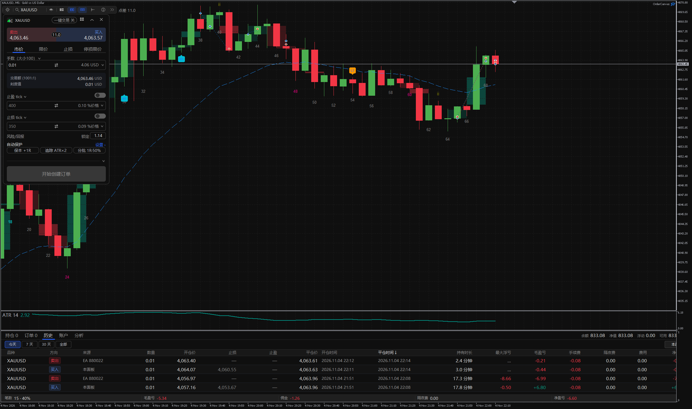

4. **Account**: clean breakdown of Balance, Equity, Margin, Free Margin, Margin Level, and Leverage.
5. **Analytics**: built-in strategy report — **post-cost cumulative equity & drawdown curve**, win rate, profit factor, P&L distribution, Long vs. Short, net breakdown by weekday / close hour / holding time, and planned stop risk vs. actual MAE.

---

## 5. Automated Protection & Pre-Trade Risk Guards

All automated rules are opt-in (off by default) and organized into clear parent-child Bento cards under `Settings → Automation` with curated one-click **Presets**:

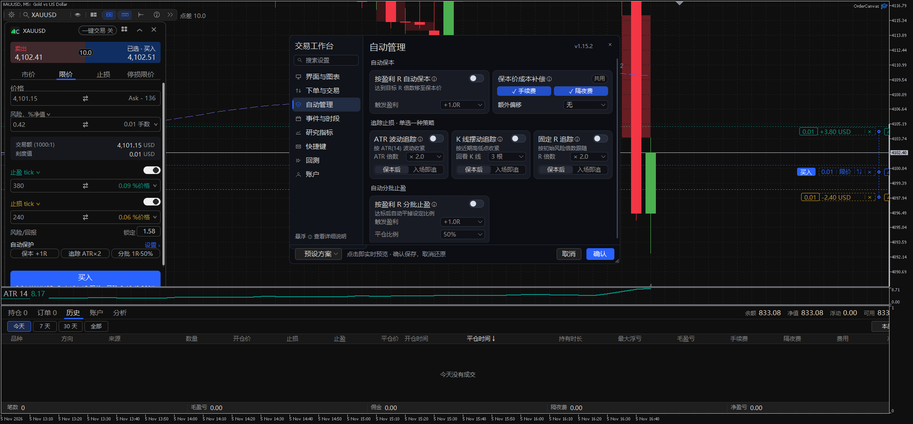

### 5.1 Initial Risk Unit (`1R`)

When a position is first seen with a stop loss, OrderCanvas records the **Entry-to-Initial-Stop distance as `1R`** and persists it across terminal restarts so subsequent stop adjustments never distort your R multiples.

### 5.2 Three Automated Position Rules

| Strategy | Trigger | Execution Behavior |
|---|---|---|
| **Auto Break-Even** | Floating profit reaches `+xR` (e.g. `+1.0R`) | Moves stop loss once to `Entry + round-turn commission + swap + optional extra offset` |
| **Trailing Stop** | Evaluated on each **closed bar**, **tightening only (never loosens)**; starts immediately or after break-even | Choose between three independent methods: • **`ATR(14) × multiple`** • **Swing High / Low of last `N` closed bars** (adds spread on shorts) • **Fixed `R` distance** |
| **Auto Partial Close** | Floating profit reaches `+xR` | Closes `y%` of current volume (rounded to broker lot step) once per position |

> [!WARNING]
> **Client-side execution**: automated break-even, trailing stops, and staged exits run inside the OrderCanvas EA on your PC or VPS. Keep MetaTrader 5 and the chart open while positions rely on them.

### 5.3 Pre-Trade Risk Caps

- **Max Spread Guard**: blocks new entries whenever live spread exceeds your point cap (the toolbar spread pill turns red) while leaving closes and modifications unrestricted.
- **Max Risk % per Trade**: refuses order submission if planned stop loss exceeds your configured `% of equity` ceiling.

---

## 6. In-Chart Historical Replay Mode

Practice price action and execution right on your live chart layout without opening MetaTrader's separate Strategy Tester window:

1. **Enter in place**: click **Replay** in the top toolbar (next to Hotkeys) and choose any historical start date. OrderCanvas downloads and verifies broker M1/tick history in the background while keeping your symbol name and templates intact.
2. **Floating transport player**: step forward 1 bar at a time or play continuously at **1 tick, 1 second, 1 minute, or 5 minutes** across **9 speeds**. The price-scale candle countdown ticks along with the replay clock, and manual chart panning stays unlocked during playback.
3. **Isolated virtual broker ledger**: place Market, Limit, Stop, and Stop-Limit orders, drag SL/TP, trigger break-even, staged exits, and reversals against a dedicated simulated account (including gap-open fills and 50% margin stop-out). **Your real trading account is never touched.**
4. **Synchronized multi-timeframe subcharts**: linked subcharts of the same symbol highlight the main chart's replay time span and exit Replay Mode together with the main chart.
5. **Virtual account settings**: customize starting balance, leverage, and per-lot commission — or reset the simulated ledger anytime — under `Settings → Replay`.

---

## 7. Price-Action Workbench, Native Calendar & Multi-Chart Layouts

### 7.1 Inline-Expanding Price-Action Studies

In `Settings → Studies`, click **Configure ›** on any study card to expand its **Inputs / Style / Visibility** tabs **inline inside the card** with instant live chart preview:

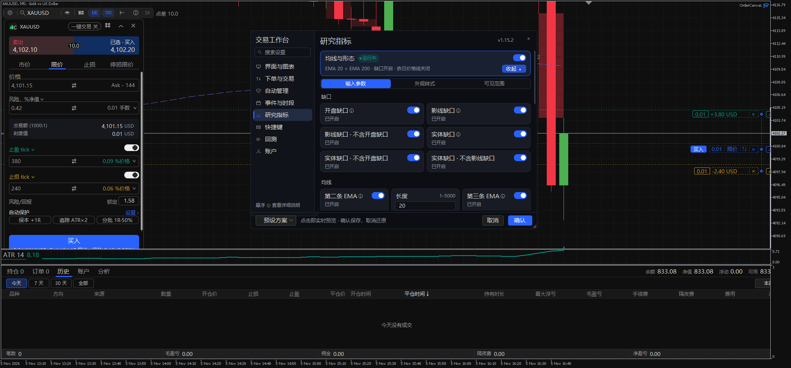

- **EMAs & Patterns**: dual EMAs (default EMA 20 + EMA 200), previous-day High / Low / Close lines, breakout & exhaustion gap zones, and inside / outside bar (`i`, `ii`, `ioi`) labels.
- **Bar Count**: session bar numbering with highlighted interval multiples (shown on `M5` by default; customizable per timeframe under `Visibility`).
- **Entry Signals (`H1 / H2 / L1 / L2`)**: automatic first- and second-entry pullback badges with optional bar-close alerts.

### 7.2 Zero-Setup Economic Calendar, Sessions & Two-Stage Toasts

In `Settings → Events`:

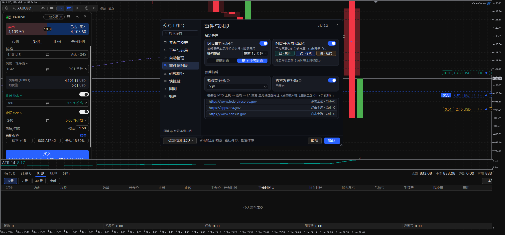

- **Native MT5 Calendar (no WebRequest required)**: plots high- and medium-impact macro events for your symbol's currencies along the bottom timeline. Hover for Actual / Forecast / Previous values; click for full history.
- **Tokyo / London / New York Sessions & Holidays**: automatic DST conversion plus holiday `H` (`休`) markers on major market closures.
- **Two-Stage Auto-Retracting Reminder Toasts**: consolidated top-right reminder cards appear ahead of releases/sessions, **auto-retract after 12 seconds** (pausing while hovered), and **re-appear 1 minute before the event** for a clean final heads-up.
- **Copyable Official Headline URLs**: if you enable official central-bank / statistics headlines, the required URLs sit in read-only edit boxes ready to select and copy (`Ctrl+C`) into MT5's `Tools → Options → Expert Advisors` allowlist.

### 7.3 Linked Subcharts & 8 Workspace Layouts

Click **Subcharts** in the toolbar to open real MT5 companion charts in any timeframe across **8 tiled layouts**, complete with compact order-line chips and shaded time-span bands.

---

## 8. Workbench Settings (Instant Live Preview), Hotkeys & Troubleshooting

### 8.1 Instant Click-to-Preview, Drag-Resize & Custom `#HEX` Colors

Open **Settings** (gear icon on the top-left toolbar):

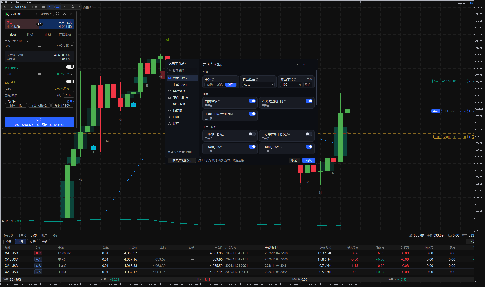

- **Instant Live Preview (no separate Preview button)**: flipping any switch, choosing **Auto / Light / Dark** theme, resizing order lines, tuning study parameters, or picking custom colors **applies live to the chart, ticket, order lines, and dock immediately on click**. Click **`OK` (`确认`)** to save permanently, or click **`Cancel` (`取消`)** / `×` / `Esc` to cleanly roll back every previewed change (previewing `Automation` rules never alters live open positions before `OK`).
- **Drag-Resizable Edges & Corners**: drag any border or corner of the Settings window (`840×520` up to full chart size, remembered automatically) with stepless 1 px smooth wheel scrolling.
- **5 Custom Theme Color Roles + 16-Color Palette & `#HEX / RGB`**: customize **Accent / Buy, Sell / Loss, Profit / Take-Profit, Stop-Loss, and Surface Background** independently for Dark and Light themes via the 16-swatch grid or any `#RRGGBB` / `R,G,B` value.

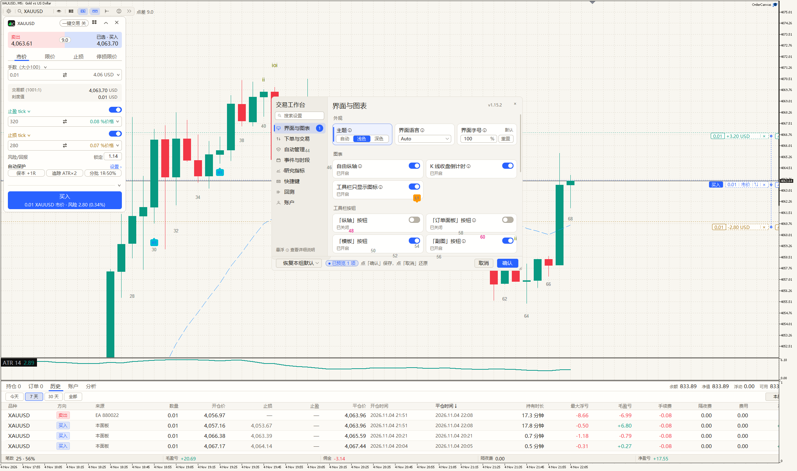

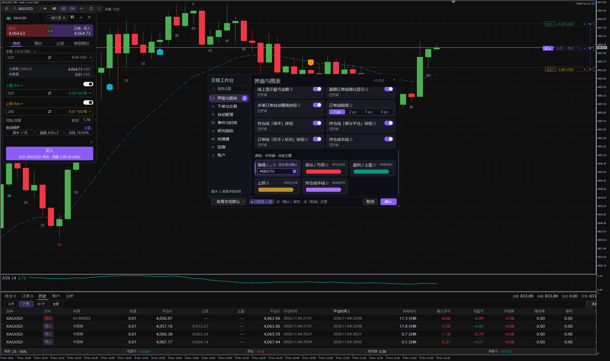

### 8.2 Default Hotkeys Reference (Press-to-Bind)

> [!NOTE]
> Hotkeys stay inactive until you toggle **Hotkeys** ON in the top toolbar (hover the toolbar icon anytime to view your active bindings). Rebind any action under `Settings → Hotkeys` simply by clicking its box and pressing a key or combo.

| Action | Default Key | Behavior |
|---|---|---|
| **Buy Market / Sell Market** | `B` / `S` | Sends a Market Buy or Sell order using current ticket size & exits |
| **Pointer-Follow Pending Buy / Sell** | `Shift+B` / `Shift+S` | Pending draft follows the mouse (`Limit` or `Stop` by side of market); **left-click places, right-click / `Esc` cancels** |
| **Pull / Move Stop Loss** | `L` | Grabs the draft or trade nearest the pointer (auto-seeds unpriced pending drafts at market); **left-click sets active SL** |
| **Pull / Move Take Profit** | `P` | Same as above for active Take Profit with live projected reward |
| **Cycle Order Types** | `Shift+T` | Cycles through enabled order types (`Market / Limit / Stop / Stop Limit`) |
| **Move Position to Net Break-Even** | `E` | Moves focused position's stop to cost-adjusted break-even (or sets TP at BE if underwater) |
| **Exit All Same-Side at Average Cost** | `Shift+X` | Sets all positions on the same side to exit at their combined average-cost line |
| **Partial Close (default 50%)** | `H` | Partially closes the focused position |
| **Close All (current symbol)** | `X` | Closes all open positions on the chart's symbol |
| **Collapse / Expand Ticket** | `C` | Folds or unfolds the left order ticket |

### 8.3 Quick Troubleshooting

- **Submit button disabled or "Algo Trading is off"**: ensure both MT5's top **Algo Trading** button is green and `Allow Algo Trading` is checked in `OrderCanvas → Properties → Common`.
- **Risk % / Risk Money shows 0 lots on a small account**: verify a stop distance exists (active or gray reference) and that your risk budget covers at least the broker's minimum `0.01` lot at that stop distance.
- **Diagnostics log**: inspect `MQL5/Files/OrderCanvas/diagnostics.log` (or send diagnostics under `Settings → Account`) — contains timing and error codes only, never passwords or account balances.

---

## Appendix: Installation & License Activation (GitHub / Self-Hosted Edition)

> *Note: Chapters 1–8 cover core OrderCanvas workflows across all editions. This appendix applies specifically to the standalone package from GitHub Releases or the official website (MQL5 Market users install directly via MT5 Navigator → Market).*

### A.1 Download & Install

1. Download `OrderCanvas-1.15.2.zip` from [GitHub Releases](https://github.com/lichunboa/OrderCanvas/releases/latest) or [getordercanvas.com](https://getordercanvas.com/oc/shop) and extract it.
2. **Windows**: run **`OrderCanvas-Installer.exe`** (auto-detects installed and portable MT5 terminals, supports Select All / Deselect All, syncs both `AppData` and portable `MQL5` folders, and verifies every file write; `Install.bat` is also included).
3. **macOS**: open **Terminal**, type `bash ` (with a trailing space), drag **`Install-Mac.command`** into the window, and press `Return`.
4. Right-click **Navigator → Expert Advisors → Refresh** in MT5 (or restart MT5) and drag **`OrderCanvas`** onto a chart.

### A.2 Online Activation & Offline License Keys

- **Option 1 — One-Click Online Activation (Recommended)**:
  1. Bind your MT5 account number at [getordercanvas.com](https://getordercanvas.com/oc/shop) or via [@OrderCanvasbot](https://t.me/OrderCanvasbot) on Telegram (free trial plus Monthly, Yearly, and Lifetime plans; paid plans bind up to 2 MT5 accounts with self-service rebinding).
  2. In MT5 `Tools → Options → Expert Advisors`, enable **Allow WebRequest for listed URL** and add `https://getordercanvas.com`.
  3. Click **Online Activation** on the on-chart license card.
- **Option 2 — Offline Activation Key**:
  - Copy your `OC1-...` key from the Buyer Center or Telegram bot, paste it into the on-chart license card, and click **Activate** (works completely offline).

---

*Risk Disclosure: Trading foreign exchange, metals, indices, and CFDs on margin carries a high level of risk and may not be suitable for all investors. OrderCanvas is a chart execution and analytics utility and does not provide financial advice or trading signals.*
