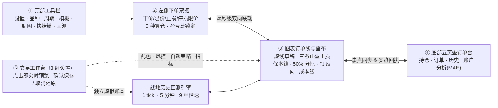
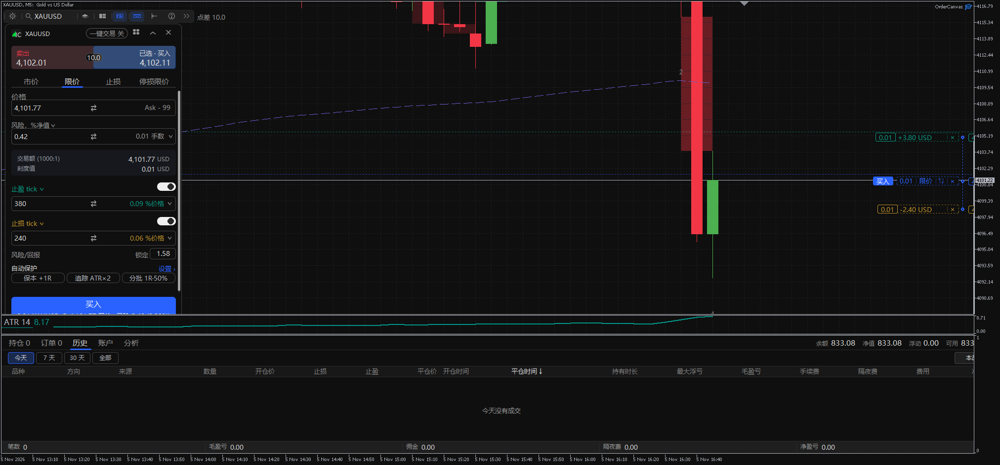
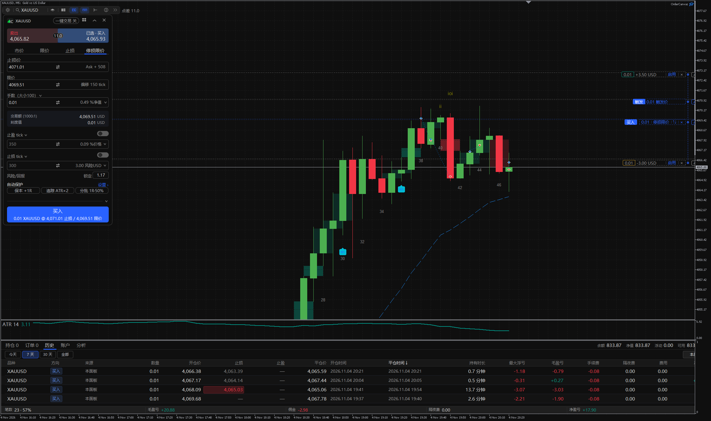
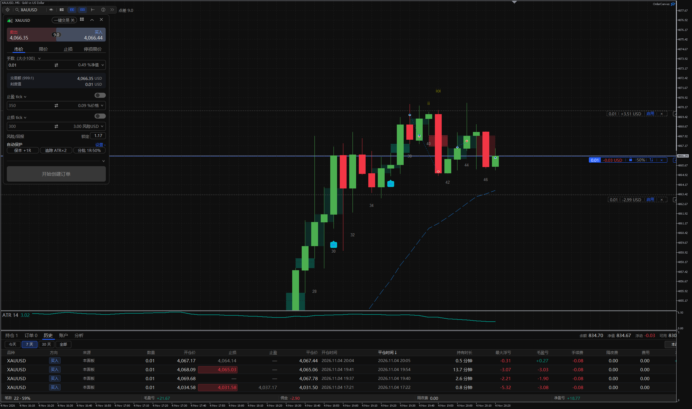
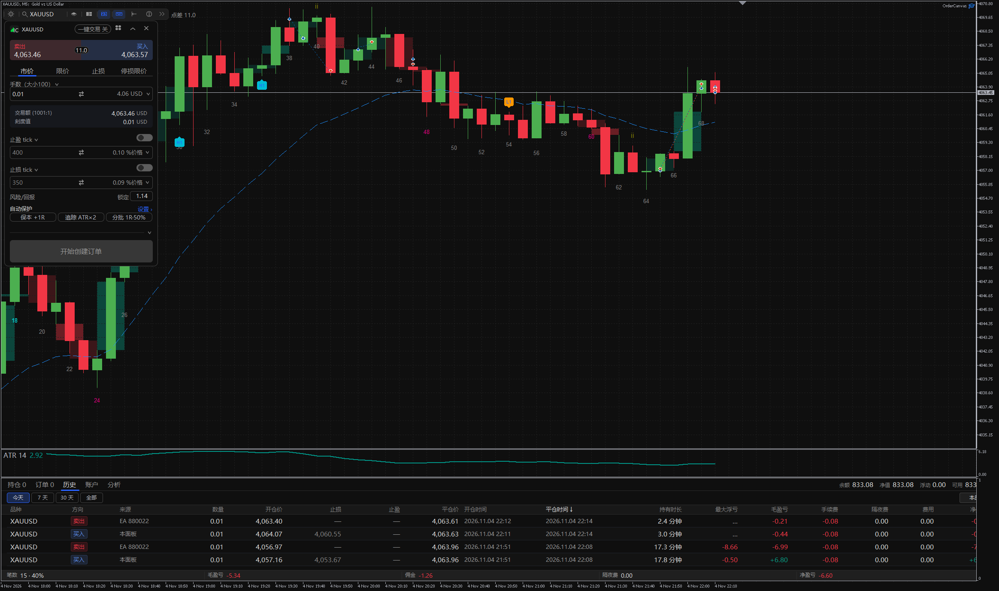
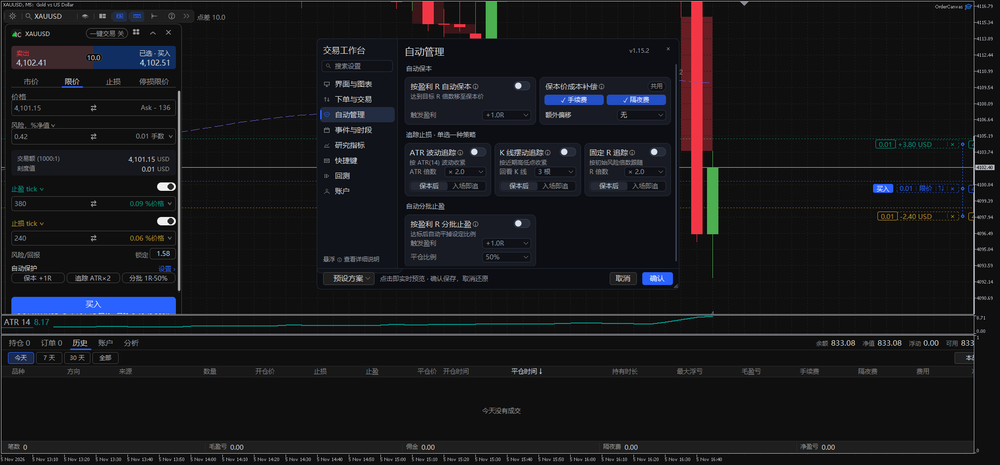
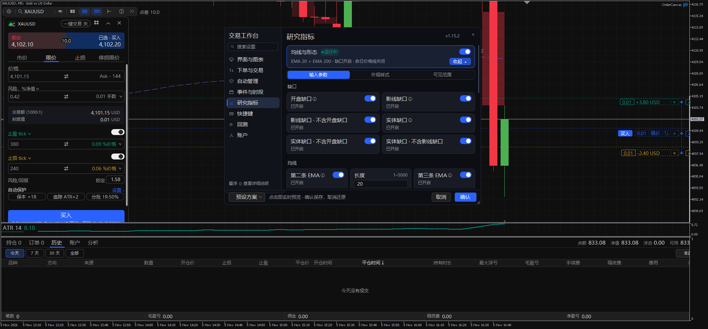
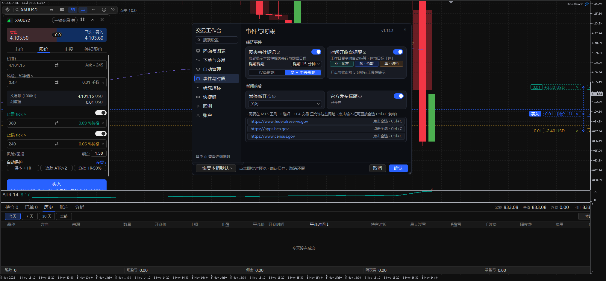
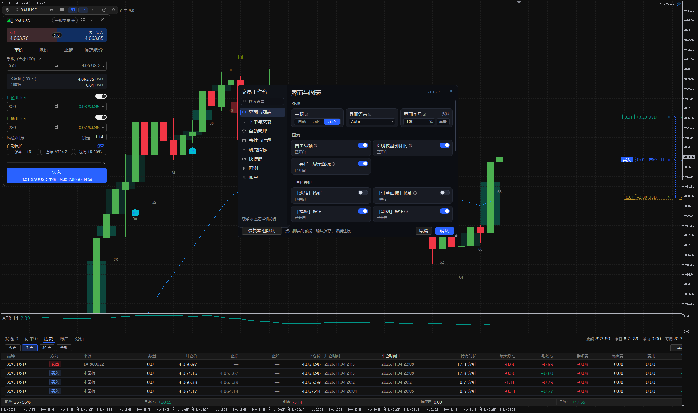
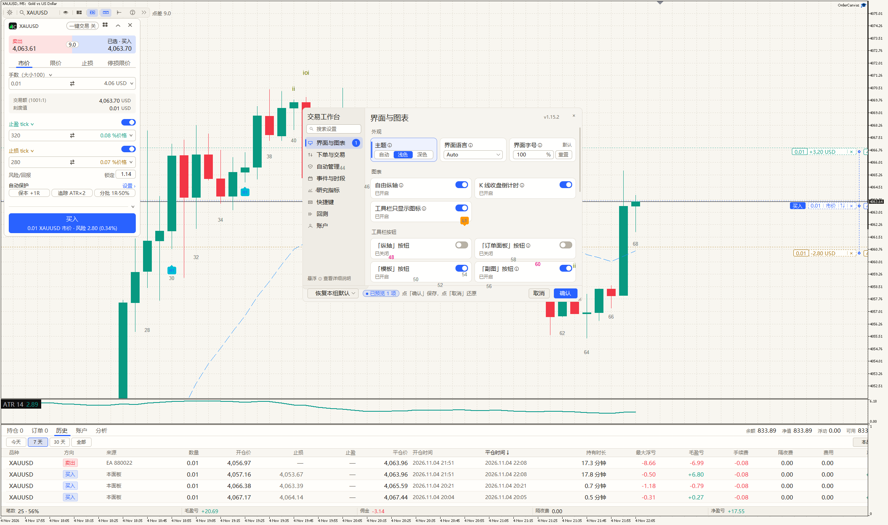

# OrderCanvas for MetaTrader 5 — 使用说明书（v1.15.2）

**中文** · [English](USER_GUIDE.md) · [返回首页](../README.zh-CN.md) · [功能清单](FEATURES.zh-CN.md) · [安装指南](INSTALL.md)

OrderCanvas 是专为 **MetaTrader 5（MT5）** 打造的原画布交易工作台（纯 MQL5 编写，零 DLL，支持 Windows 与 macOS）。它将**发单前虚线预演、以损定仓、图表订单线直控、含成本自动防守、当前图表就地历史回测、价格行为研究与净值复盘**整合在同一块 MT5 图表画布内。

---

## 目录

1. [快速上手与五大交互区总览](#1-快速上手与五大交互区总览)
2. [计划与下单：左侧交易面板详解](#2-计划与下单左侧交易面板详解)
3. [图表订单线与三态止盈止损](#3-图表订单线与三态止盈止损)
4. [跨渠道订单管理与底部五页签面板](#4-跨渠道订单管理与底部五页签面板)
5. [自动保护策略与风控拦截](#5-自动保护策略与风控拦截)
6. [图表就地历史回测（Replay Mode）](#6-图表就地历史回测replay-mode)
7. [价格行为工作台、原生财经日历与多图工作区](#7-价格行为工作台原生财经日历与多图工作区)
8. [交易工作台（8 组设置中心）、快捷键全表与常见排障](#8-交易工作台8-组设置中心快捷键全表与常见排障)
- [附录：安装与授权激活（GitHub / 自营版）](#附录安装与授权激活github--自营版)

---

## 1. 快速上手与五大交互区总览

### 1.1 工作台整体架构

OrderCanvas 按「**计划 → 执行 → 防守 → 复盘**」的完整交易闭环划分为五大交互区，所有数据与 MT5 终端报价、持仓、历史成交实时双向同步：

| 区域编号 | 区域名称 | 所在位置 | 核心职责 |
|---|---|---|---|
| **①** | **顶部工具栏** | 图表左上角横条 | 打开设置、搜索切换品种、切周期、套用模板、开启多周期副图、显隐面板、开关快捷键、进入**回测模式**、查看实时点差 |
| **②** | **左侧下单票据** | 图表左侧（可悬浮/停靠/收起） | 选择买卖方向与订单类型、按固定风险自动算手数、切换止盈止损单位、锁定盈亏比、切换自动保护胶囊 |
| **③** | **图表订单线与画布** | K 线主图与右侧价格轴 | 发单前拖拽虚线草稿、切换彩色真实止盈止损与灰色参考线、持仓线一键净保本/平半仓/反手、拖出 3 档分批止盈、查看价格行为与日历事件 |
| **④** | **底部五页签订单台** | 图表底部独立窗格（可折叠/最大化） | 管理持仓与挂单（含手机端与其他 EA 订单）、表格内直接改止盈止损、核对历史成交来源与触发价、查看扣除成本后的净值曲线与单笔 MAE |
| **⑤** | **交易工作台（设置中心）** | 居中可拖拽缩放模态窗 | 8 大独立分组、跨组搜索、16 色板 + `#HEX` 自定义配色、内联展开研究指标、点击即实时预览到图表 |

### 1.2 首次加载与模板套用

> [!TIP]
> **默认不破坏你的原有图表**：首次将 `OrderCanvas` 拖入图表时，仅加载交易面板与图表订单线，不会擅自改动你原有的 K 线配色或删除已有指标。

如果你想一键获得截图中的专业工作区配色与指标组合：
1. 确保 MT5 顶部工具栏的 **「算法交易（Algo Trading）」** 为绿色开启状态。
2. 点击图表左上角工具栏的 **「模板」** 按钮，从 6 套内置预设中任选一套一键套用：
   - **价格行为（Price Action）**：内置开源 `TVStudySuite`（EMA 20 / 200、缺口带、`ii`/`ioi`、前日高低位、K 线计数、`H1/H2/L1/L2` 入场标记）+ `OC ATR 14`
   - **纯净 K 线（Clean Candles）**：清爽深/浅色 K 线画布，无额外副图指标
   - **均线趋势（EMA 20 / 50 / 200）**、**布林带 + RSI**、**MACD + EMA 20**、**成交量 + EMA 20**
3. 首次启动会自动弹出 **7 步可拖动交互式新手引导**；随时可点击工具栏 `?` 按钮重新打开。

---

## 2. 计划与下单：左侧交易面板详解

左侧下单票据遵循 **「先预演、后发单」** 原则：在未开启「一键交易」时，无论怎么切换方向、修改价格或拖动图表虚线，**只要不点击最底部的蓝色/红色下单主按钮，绝不会向经纪商发出任何订单**。

### 2.1 四种订单类型与自动出草稿线

- **市价（Market）**：按当前最优买/卖报价立即成交。
- **限价（Limit）**：挂出回调接多（Buy Limit）或反弹做空（Sell Limit）挂单；若你将买入限价线拖到现价上方（或卖出限价拖到现价下方），MT5 也支持按更优限价立即撮合。
- **止损（Stop）**：挂出突破追多（Buy Stop）或跌破追空（Sell Stop）挂单。
- **停损限价（Stop Limit）**：先设一条 **「触发价（Trigger）」** 线，当行情触及触发价后，自动在指定的 **「限价（Limit）」** 位置挂出限价单。

> [!NOTE]
> **改任意数值自动唤出草稿线**：处于未选方向的中性状态时，只要点击订单类型（市价 / 限价 / 止损 / 停损限价）或直接修改手数、金额、止盈止损任一输入框，图表会立即生成可视化的虚线草稿订单线。

### 2.2 五种算仓模式（以损定仓核心）

点击票据「单位」下拉框，可在 5 种仓位计算方式间无缝切换，右侧实时显示等值折算结果：

| 算仓模式 | 你输入的数值 | 面板自动为你计算 | 适用场景 |
|---|---|---|---|
| **手数（Lots）** | 固定交易手数（如 `0.10`） | 所需保证金、止损对应的亏损金额与 `%净值` | 习惯固定手数交易 |
| **保证金（Margin）** | 拟占用的保证金金额（如 `200 USD`） | 结合当前品种杠杆折算可开手数 | 小资金或高杠杆仓位控制 |
| **%净值（% Equity）** | 占用账户净值的百分比 | 按含浮动盈亏的实时净值折算手数 | 按名义仓位比例配置 |
| **风险金额（Risk Money）** | 单笔最大可承受亏损（如 `100 USD`） | **根据入场线到止损线的距离动态反推合规手数** | 固定金额风控（止损拉宽手数自动变小） |
| **%风险（Risk %）** | 单笔风险占实时净值比例（如 `1.0%`） | **根据实时净值 × 风险比例 ÷ 止损距离毫秒级算手数** | 机构与职业交易员标准「以损定仓」 |

### 2.3 止盈止损单位换算与盈亏比锁定

- **多单位双向换算**：止盈与止损各自支持按 **盈亏金额（账户货币）**、**tick / 点数**、**绝对价格**、**价格变动 `%`**、**外汇标准点（pips）** 或 **`%净值`** 输入；切换单位或手数暂时无效时，已设定的价格位始终保留不丢失。
- **盈亏比 `锁定`（R:R Lock）**：在「风险/回报」行输入目标比例（如 `2.0`）并点亮 **「锁定」** 胶囊——此后无论在面板改数字还是在图表拖动止损线，止盈线都会自动按 `2.0R` 同步缩放。
- **底部错误直报**：若止损距离小于券商停损限制、挂单方向放反、或账户净值不足最小 `0.01` 手，输入框上方与底部主按钮会直接写出具体原因（如 *「金额太小：最小 0.01 手需要 … USD」*）。

### 2.4 一键交易、折叠票据与 5 组下单预设

- **一键交易胶囊**：点亮票据顶部的 `一键交易` 后，点击顶部红/蓝实时报价块即可直接市价成交（切到限价/止损页签时按面板价立即挂单），同时市价页底部按钮变为 **「一键平仓」**。
- **收起/展开票据**：点击票据右上角 `^` 箭头可折叠为精简横条（仅保留买卖报价、订单类型、手数与发单键），释放更多 K 线视野。
- **5 组下单预设**：点击票据右上角九宫格图标，可将常用的「订单类型 + 偏移点数 + 止盈止损 + 有效期」保存为最多 5 组预设方案，盘中一键调取。

---

## 3. 图表订单线与三态止盈止损

在 OrderCanvas 中，**每一笔草稿、挂单和持仓都是图表上一条可直接拖拽与点击的交互线**，彻底告别右键弹出 MT5 原生改单窗口的繁琐步骤。

### 3.1 止盈 / 止损三态工作流（彩色实单 · 灰色参考 · 完全隐藏）

许多交易员在以损定仓或预防扫损时，希望 **「按参考止损位精确算手数并在图上保留防守视觉参考，但发单时不向券商服务器提交真实止损」**。OrderCanvas 通过直觉化的三态机制解决这一需求：

| 状态 | 触发方式 | 图表视觉表现 | 券商端与算仓行为 |
|---|---|---|---|
| **① 彩色启用态（真实保护）** | 打开票据止盈/止损开关，或在图上按快捷键 `L` / `P` | 绿色（止盈）/ 琥珀色（止损）虚线或实线，显示预期盈亏金额 | 发单或改单时**直接向券商提交真实 TP/SL**；`%风险` 与 `风险USD` 实时算仓 |
| **② 灰色参考态（本地参考）** | 关闭票据止盈/止损开关（草稿或持仓已有参考位时） | 清爽的**灰色虚线**，芯片显示 `[-2.82 USD \| 启用 \| ×]` | **不向券商发送 TP/SL**，但 `%风险` 与 `风险USD` **照常按该灰色止损距离精确算仓**；成交后灰色参考线自动保留在真实持仓/挂单上！ |
| **③ 完全隐藏态** | 点击止盈/止损芯片右侧的 `×` | 从图表上彻底移除该止盈/止损线 | 不发送 TP/SL；随时可从主订单线上的 `TP` / `SL` 把手重新拖出，或直接按 `L` / `P` 拉出彩色实单保护 |

> [!IMPORTANT]
> **灰色参考线一键转正**：持仓或挂单成交后，保留在图上的灰色参考止盈/止损线只需**鼠标拖动一下**或直接点击线上的 **「启用」** 按钮，即可立即向券商提交为真实的止盈/止损订单！

### 3.2 面板「买/卖切换」与订单线 `⇅` 反向的区别

为了兼顾「反方向挂同类型单」与「同一关键位多空互换」两种高频场景，OrderCanvas 将两处操作做了清晰分工：

| 你点击的位置 | 执行逻辑 | 典型用法举例 |
|---|---|---|
| **点击左侧票据顶部「买入 / 卖出」** | **镜像偏移（保持订单类型不变）**：按当前买卖价对称镜像挂单偏移距离，限价单仍是限价单、止损单仍是止损单 | 刚看完 `Buy Limit`（现价下方接多），想切到现价上方挂一笔 `Sell Limit` 逢高做空 |
| **点击图表订单线上的 `⇅` 按钮** | **同价反向（限价 ↔ 止损互换）**：价格线留在原位不动，方向反转并自动切换限价/止损类型，止盈止损按原距离对调 | 原本在 `4050` 挂 `Buy Limit` 接多，判断该位跌破将转空，点线上 `⇅` 直接原位改为 `4050 Sell Stop`（真实挂单若被券商拒绝会自动恢复原单及灰色参考线） |

### 3.3 持仓线直控、3 档分批止盈止损与平均成本线

- **持仓线全功能胶囊 `[手数 | 浮动盈亏 | 锁 | 50% | ⇅ | ×]`**：
  - **保本锁（锁图标）**：默认计入**双边手续费 + 隔夜利息**（可在设置增设额外点数偏移）。当市价已越过净保本位时锁图标变绿，点击即将止损移至净保本价；若市价尚未越过成本区（处于浮亏），点击则将**止盈**设在净保本价，方便回本自动离场。
  - **部分平仓（`50%`）**：一键平掉设定比例仓位（比例可在设置自定义）。
  - **反手（`⇅`）**：平掉当前持仓并立即按同手数反向开仓。
  - **平仓（`×`）**：立即市价平掉该笔持仓（未开一键交易时在线旁二次确认）。
- **向外拖出最多 3 档分批止盈 / 止损**：按住持仓线上的 `50%`（或分批把手）向盈利方向拖出即可创建 `TP1 / TP2 / TP3` 分批止盈线，向亏损方向拖出即可创建分批减仓止损线；点击分批标签可在 `25% / 33% / 50% / 67% / 75% / 100%` 间切换比例，重启 MT5 自动持久保留。
- **同向多仓平均成本线**：同一方向持有 2 笔及以上仓位时，图表自动绘制紫色虚线 **平均成本线**；点击成本线上的锁按钮或按默认快捷键 `Shift+X`，即可将同方向所有持仓统一设为在综合保本价离场。
- **挂单时钟（有效期直改）**：挂单线上自带时钟图标，点击即可在图上直接切换 `撤销前有效 (GTC)`、`当日有效` 或 `1 / 4 / 24 小时`（自动标出对应的券商服务器到期时间）。
- **线上价格框与就地编辑器**：点击每条线最右侧的价格框可直接键盘输入精确价位；点击持仓盈亏数字则在订单线旁展开轻量改单框（支持改数量进行减仓或加仓）。

### 3.4 多笔订单焦点同步与 `···` 自动精简

当图表同时存在 2 笔及以上持仓或挂单时：
- **全局焦点同步**：在图表点击任意订单线、在底部面板点击某一行、或移动鼠标使用快捷键，**图表订单线、底部订单行、改单框与快捷键始终锁定同一笔焦点订单**。
- **非焦点订单自动折叠为 `···`**：为避免多笔订单密集排列时按钮互相遮挡，非焦点订单线会自动隐藏次要操作键并浓缩为清爽的 `···` 标记；鼠标悬停、点击 `···` 或选中该单时立即完整展开。

---

## 4. 跨渠道订单管理与底部五页签面板

### 4.1 管理手机端、网页端与其他 EA 的订单

在「交易工作台 → 下单与交易」中，**「管理其他来源的订单」** 默认开启：
- 你在 **手机 MT5、电脑原生窗口、网页端（手动单 Magic 0）** 以及 **其他 EA（带各自 Magic Number）** 开出的当前品种持仓与挂单，都会完整显示在图表订单线和底部订单面板中，支持直接拖拽设止盈止损、一键保本、部分平仓和撤单。
- **严格的安全边界**：OrderCanvas 的**自动保本、自动追踪止损、自动分批止盈与平均成本线**仅作用于本面板开出的订单和手动单（Magic 0），**绝不会自动修改或平掉其他 EA 管理的策略订单**。若你希望完全隔离，关闭该开关即可恢复只管理本面板订单。

### 4.2 底部五页签订单与复盘面板详解

底部面板占据独立副图下方的专属区域（支持拖拽分隔条调整高度、一键最大化或折叠收起；折叠时顶栏依然每 0.25 秒实时刷新净值与总浮盈）：

1. **持仓（Positions）**：实时展示品种、方向、**来源**（`本面板` / `手机` / `网页` / `电脑端` / `EA + Magic`）、数量、开仓价、现价、**可直接点击编辑的止损 / 止盈单元格**（输入价格回车即改，点单元格右侧 `×` 直接移除；**其他品种的持仓无需切换图表即可在此改单或平仓**）、距现价点数与净浮盈。
2. **订单（Orders）**：管理全部工作挂单，同样支持显示来源、表格内直改止盈止损与一键撤单。
3. **历史（History）**：支持按 `今天 / 7天 / 30天 / 全部` 及 `全部品种 / 当前品种` 筛选；完整展示每笔已平仓交易的 **来源**、**关联止损 / 止盈价位**（止损或止盈触发平仓时自动以醒目色块高亮）、持有时长、**单笔最大浮亏（MAE）**、毛盈亏、手续费、隔夜费与真实净盈亏。点击任意持仓、挂单或历史行，主图会自动平移定位到该笔交易发生的 K 线位置！

4. **账户（Account）**：分栏清晰呈现账户余额、含浮盈净值、已用保证金、可用保证金、保证金比例与账户杠杆。
5. **分析（Analytics）**：免导出 HTML 报表的策略级复盘台——内置 **扣除双边手续费与隔夜费后的累计净值与回撤曲线**、胜率、盈亏比、利润因子、盈亏分布直方图、多空对比、按星期 / 平仓小时 / 持有时长拆分的净收益矩阵，以及单笔计划风险 vs 实际承受风险（MAE）对照。

---

## 5. 自动保护策略与风控拦截

所有自动保护规则默认关闭，可在左侧票据底部的胶囊栏快速点亮，或在「交易工作台 → 自动管理」中按父子卡片精细配置（支持一键套用预设方案）：

### 5.1 初始风险单位 `R` 的定义

当一笔持仓首次带有止损时，OrderCanvas 会将 **「开仓价到初始止损价的距离」** 记录为该笔持仓的 **`1R`** 并持久化保存（即使中途重启 MT5 或后续移动了止损，`1R` 基准依然恒定不变）。

### 5.2 三大自动持仓管理策略

| 策略模块 | 触发条件与参数 | 执行细节 |
|---|---|---|
| **自动保本（Auto Break-Even）** | 浮动盈利达到 `+xR`（如 `+1.0R`，支持自定义） | 自动将止损移至「开仓价 + 双边手续费 + 隔夜费 + 额外偏移点数」，每笔持仓仅触发一次 |
| **自动追踪止损（Trailing Stop）** | 每根 K 线收盘结算，**只向有利方向收紧、绝不回退放宽**；可选「开仓后立即追踪」或「保本后再启动追踪」 | 提供三种算法独立切换： • **`ATR(14)` 倍数**：按最新收盘 ATR × 倍数留出波动呼吸空间 • **摆动高低点**：跟随最近 `N` 根已收盘 K 线的最低/最高点（空单自动计入点差） • **固定 `R` 距离**：保持固定倍数 `R` 的追踪距离 |
| **自动部分平仓（Auto Partial Close）** | 浮动盈利达到 `+xR` | 自动平掉当前持仓量的 `y%`（按品种最小步长取整），锁定落袋利润，每笔触发一次 |

> [!WARNING]
> **客户端运行前提**：自动保本、追踪止损、分批止盈止损均由你本机或 VPS 上的 OrderCanvas EA 执行（并非券商服务器原生挂单），持仓期间请保持 MT5 终端与当前图表处于开启联网状态。

### 5.3 开仓前风控拦截

- **最大允许点差（Max Spread）**：当品种实时点差超过你设定的上限时，自动拦截新开仓请求（工具栏点差胶囊变红预警），防止在流动性枯竭或数据瞬间高滑点进场；平仓与改单不受限制。
- **单笔最大风险上限（Max Risk %）**：当一笔草稿的止损亏损占净值比例超过设定上限时，拒绝发单并在按钮上明确提示超限。

---

## 6. 图表就地历史回测（Replay Mode）

无需打开笨重的 MT5 策略测试器窗口，也无需脱离你熟悉的日常图表模板与多周期布局：

1. **一键进入回放**：点击顶部工具栏（快捷键右侧）的 **「回测模式」**，在日历中选择任意历史起始日期，当前图表即刻就地切入历史回放状态（自动在后台下载并核对经纪商历史数据，不卡顿图表）。
2. **悬浮播放控制条**：屏幕上方居中显示轻量播放卡，支持 **单步推进 1 根 K 线**、**播放 / 暂停**、**`1 tick` / `1 秒` / `1 分钟` / `5 分钟`** 四种更新粒度与 **9 档倍速**；右侧价格轴上的 K 线收盘倒计时会严格跟随回放时钟逐秒跳动，回放中你仍可自由拖拽平移图表。
3. **完全隔离的虚拟交易账本**：回放期间，你可以像实盘一样使用左侧票据与图表订单线进行市价、限价、止损、停损限价、保本、分批止盈与反手练习，底部五页签面板实时统计虚拟账户的持仓、历史与净值分析（含跳空按开盘价成交与 50% 保证金强平模拟），**真实交易账户资金与订单 100% 零触碰**。
4. **多周期副图同步联动**：开启同品种副图（如主图 M5 + 副图 H1）时，副图会自动标出主图回放所处的时间带，退出回放时主副图一并恢复实时行情。
5. **虚拟账户配置**：在「交易工作台 → 回测」页可随时修改回测初始资金、虚拟杠杆、每手单边手续费，或一键重置虚拟账本。

---

## 7. 价格行为工作台、原生财经日历与多图工作区

### 7.1 内置价格行为研究指标（内联手风琴直调）

打开「交易工作台 → 研究指标」，三大价格行为模块以状态卡片呈现，点击任意卡片上的 **「配置 ›」** 即可**在当前页直接内联展开**「参数 / 样式 / 可见范围」三栏（无需跳转二级页面），修改任意数值立即在背景图表实时预览：

- **均线与形态**：双指数均线（默认 EMA 20 + EMA 200）、前一日最高/最低/收盘关键水平线、突破与衰竭缺口色带、内包线（`i` / `ii`）与外包线（`ioi`）自动识别。
- **K 线计数（Bar Count）**：按日内交易时段自动对 K 线编号计数并高亮关键倍数 K 线（默认仅在 `M5` 周期显示，可在「可见范围」勾选任意周期）。
- **入场信号（H1 / H2 / L1 / L2）**：自动识别顺势回调第一次与第二次入场结构（多头 `H1/H2`、空头 `L1/L2`），支持收盘提醒。

### 7.2 免联网财经日历、交易时段与两段式提醒

打开「交易工作台 → 事件与时段」：

- **MT5 原生财经日历（免配置 WebRequest）**：直接读取 MT5 内置宏观日历，在图表底部时间轴上方标出与当前品种货币相关的高/中等影响事件图标（橙色=高影响，灰色=中等影响，央行会议与讲话为方形图标）。悬停查看前值/预测/公布值，点击展开详情与最近 6 期历史记录。
- **亚 / 欧 / 美三大时段与节假日「休」字标记**：自动换算东京、伦敦、纽约开收盘时间与夏令时，主要节假日（圣诞、元旦、感恩节、日本黄金周等）自动标 `休` 并静默当日提醒。
- **清爽的两段式右上角提醒卡片**：重要数据或开收盘前（默认提前 15 分钟 / 5 分钟）在图表右上角弹出合并后的倒计时卡片，**展示 12 秒后自动收起**（鼠标悬停在卡片上会暂停收起），并在事件发生**前 1 分钟再次弹出最终提醒**，既不漏看关键节点，也不长时间遮挡 K 线。
- **高影响新闻前后自动暂停新开仓**（可选）：规避非农、CPI、利率决议瞬间的剧烈双向扫损。
- **可复制官方发布网址**：若需在事件详情中加载美联储/统计局官方原文标题，面板底部提供的网址框支持直接鼠标框选并按 `Ctrl+C` 复制到 MT5 `工具 → 选项 → EA 交易` 白名单中。

### 7.3 多周期副图与 8 种窗口排布

点击顶部工具栏 **「副图」** 按钮，可一键为当前品种打开任意周期的真实 MT5 联动副图，并提供 **8 种分屏排布**（如左大右二小、双图并排、四宫格等）：
- 副图自动保持精简表头（仅展示品种与周期），默认精简订单线标签（鼠标移上自动展开完整按钮），并自动阴影标出主图当前可视的时间跨度。
- 点击「单图」一键关闭副图回到单画布；点击「交还 MT5」保留图表窗口由 MT5 原生平铺管理。

---

## 8. 交易工作台（8 组设置中心）、快捷键全表与常见排障

### 8.1 即点即预览、自由拖拽缩放与 `#HEX` 自定义配色

点击左上角工具栏齿轮图标打开 **「交易工作台」**：

- **点击即实时预览（无多余预览按钮）**：在 8 大分组或顶部跨组搜索框中，无论是切换浅色/深色主题、开关 K 线倒计时、调整订单线粗细、展开修改研究指标参数，还是挑选自定义颜色，**点击瞬间立即同步渲染到背后的图表、交易面板、订单线与底部面板**！满意后点右下角 **「确认」** 正式保存落盘；若只是尝试效果，点 **「取消」**（或右上角 `×` / 按 `Esc`）即可**一键丝滑还原打开设置前的全部状态**（且预览期间修改「自动管理」不会提前触碰你的真实持仓）。
- **四边与四角自由拖拽缩放**：鼠标移至「交易工作台」窗口边缘或四角即可自由拉宽拉高（支持 `840×520` 直至铺满整张图表，自动记忆尺寸），配合 1 px 无极平滑滚轮，大屏浏览更舒展。
- **深浅双主题与 5 项 `#HEX / RGB` 自定义配色**：支持「自动跟随图表背景 / 浅色 / 深色」三种模式，并可对 **强调与买入、卖出与亏损、盈利与止盈、止损、面板表面背景** 5 大色彩角色分别使用 **16 色精选调色板** 或直接输入 `#HEX`（如 `#8B5CF6`）/ `R,G,B` 定制专属视觉风格（深浅主题独立保存）。

### 8.2 默认快捷键速查表（支持「按下即绑」）

> [!NOTE]
> 为防止打字误触，快捷键默认处于关闭状态。点击顶部工具栏 **「快捷键」** 图标将其点亮后即可使用（鼠标悬停在该图标上可随时查看当前绑定的全部键位）。在「交易工作台 → 快捷键」中点击任一绑定框，直接按下键盘单键或组合键（如 `Ctrl+Shift+X`、`F2`）即可完成绑定。

| 功能动作 | 默认键位 | 交互行为说明 |
|---|---|---|
| **市价买入 / 市价卖出** | `B` / `S` | 按当前面板算好的手数与止盈止损立即发送市价买/卖单 |
| **鼠标跟随挂单（买入 / 卖出）** | `Shift+B` / `Shift+S` | 订单草稿跟随鼠标上下移动（现价下方自动为 Limit，上方自动为 Stop），**左键点击落单，右键或 `Esc` 取消** |
| **快速拉出/移动止损** | `L` | 自动锁定草稿或距离鼠标最近的那笔持仓/挂单（未设价挂单自动在现价播种），止损线跟随鼠标实时显示风险金额，**左键点击生效** |
| **快速拉出/移动止盈** | `P` | 同上，彩色止盈线跟随鼠标实时显示预期回报金额，**左键点击生效** |
| **循环切换订单类型** | `Shift+T` | 在已勾选启用的订单类型（市价 / 限价 / 止损 / 停损限价）间快速循环 |
| **单笔移至净保本** | `E` | 将焦点持仓止损移至含手续费与隔夜费的净保本价（浮亏时设止盈于保本价） |
| **同向全仓成本价保本离场** | `Shift+X` | 同方向多笔持仓时，一键将全部同向仓位设为在综合平均成本线离场 |
| **部分平仓（默认 50%）** | `H` | 按设定比例平掉焦点持仓的一部分 |
| **全部平仓（当前品种）** | `X` | 平掉当前图表品种下的全部持仓 |
| **收起 / 展开左侧票据** | `C` | 快速折叠或展开左侧下单面板 |

### 8.3 常见排障与诊断问答

<b>Q1：点击下单按钮没有反应，或提示「未开启算法交易」？</b>

请检查两处开关：① MT5 顶部主工具栏的 **「算法交易（Algo Trading）」** 按钮必须处于绿色开启状态；② 在图表右键 → `EA 交易列表` → `OrderCanvas` → `属性 → 常用` 中，确认已勾选 **「允许算法交易」**。若在真实账户首次下单，请先确认屏幕上弹出的一次性实盘风险确认卡。

<b>Q2：为什么切换到「%风险」或「风险金额」时，手数显示 0 或提示金额太小？</b>

按固定风险算仓需要同时满足两个条件：① 已存在有效的止损距离（彩色启用止损或灰色参考止损均可）；② 你的风险预算足够覆盖该止损距离下经纪商要求的最小手数（如 `0.01` 手）。若小资金账户 `0.5%` 净值不足以开出 `0.01` 手，面板会保留你的止损价位并在输入框上方提示最小手数所需的金额——调窄止损距离或适当提高风险预算即可立即恢复手数。

<b>Q3：切换模板或添加指标时，为什么 K 线曾经遮挡过面板？</b>

MT5 原生图表属性中的「图表在前景（Chart on foreground）」若被外部模板开启，会把 K 线画在所有图形界面之上。OrderCanvas 运行时会自动检测并关闭该选项，确保面板与下拉菜单始终清晰置顶。

<b>Q4：遇到界面异常或延迟时如何导出诊断日志？</b>

打开「交易工作台 → 账户」，点击诊断区的导出/发送按钮，或在 `MT5 数据文件夹 → MQL5 → Files → OrderCanvas → diagnostics.log` 查看本地诊断日志（日志仅记录界面耗时与错误码，**绝不包含账号密码、余额或持仓隐私**）。

---

## 附录：安装与授权激活（GitHub / 自营版）

> *注：以上第 1–8 章为通用功能使用说明（同样适用于 MQL5 市场版）；本附录仅针对从官网或 GitHub Releases 下载独立安装包的用户。MQL5 市场版用户请直接在 MT5 客户端「导航器 → 市场」内一键安装，无需阅读本附录。*

### A.1 下载与一键安装

1. 从 [GitHub Releases](https://github.com/lichunboa/OrderCanvas/releases/latest) 或官网 [getordercanvas.com](https://getordercanvas.com/oc/shop?lang=zh) 下载最新 `OrderCanvas-1.15.2.zip` 并解压。
2. **Windows 用户**：双击运行 **`OrderCanvas-Installer.exe`**（自动列出本机全部 MT5 与便携版目录，支持一键全选 / 取消全选、`AppData` 与便携目录双同步及逐项写入校验；若被安全软件拦截也可双击 `Install.bat`）。
3. **macOS 用户**：打开「终端（Terminal）」，输入 `bash `（注意后面带一个空格），将解压目录中的 **`Install-Mac.command`** 拖入终端窗口并回车。
4. 在 MT5 左侧「导航器 → EA 交易」右键点击 **刷新**（或重启 MT5），将 **`OrderCanvas`** 拖到任意图表上。

### A.2 联网激活与离线激活码

- **方式一：一键联网激活（推荐）**
  1. 在官网 [getordercanvas.com](https://getordercanvas.com/oc/shop?lang=zh) 或 Telegram 机器人 [@OrderCanvasbot](https://t.me/OrderCanvasbot) 绑定你的 MT5 账户号码（支持免费试用及月付 / 年付 / 永久方案，付费方案可同时绑定 2 个 MT5 账号并随时在买家中心自助换绑）。
  2. 在 MT5 顶部菜单打开 `工具 → 选项 → EA 交易`，勾选 **「允许 WebRequest 用于所列 URL」** 并添加 `https://getordercanvas.com`。
  3. 点击图表授权卡片上的 **「联网激活」**，面板即刻自动完成校验并显示有效期。
- **方式二：离线激活码（无需联网）**
  - 在官网买家中心或 Telegram 机器人复制 `OC1-...` 离线授权码，直接粘贴到图表授权卡输入框点击 **「激活」** 即可离线使用。

---

*风险提示：外汇、贵金属、股指与加密货币差价合约（CFD）属于高杠杆交易产品，可能导致本金部分或全部亏损。OrderCanvas 仅为图表交易执行与复盘辅助软件，不构成任何投资建议或交易信号。建议先在模拟账户或「回测模式」中充分熟悉各项功能后再用于实盘。*
